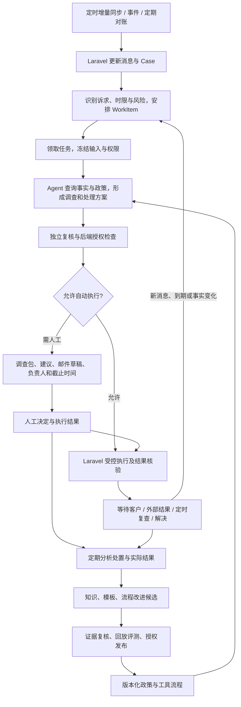

# 客服自动化目标架构

日期：2026-10-24。状态：规划草案；描述目标能力，不代表当前已经开放自动发送或订单自动操作。承接现有 Ticket 工作台、Ticket v2 与 OpenAI Agents SDK 调查实验。

当前实施范围已收敛：第一阶段自动形成“情况分析、处理意见、邮件草稿”，通过人工交互完善调查、决策路径与知识。具体以 [Ticket 智能辅助第一阶段方案](ticket-assistance-phase-one.md) 为准。自动发送是远期能力，不作为第一阶段前置条件或验收指标。

## 1. 目标与成功标准

系统持续同步客户消息，按业务时限安排工作，调查各项诉求，在授权范围内自动回复；复杂问题携带证据、建议与邮件草稿交给人工，等待结果后继续跟进。从处置结果生成知识和流程改进候选，经验证与发布后服务下一轮工作。

成功标准：消息不漏同步；紧急事项不被快速回复任务挤占；自动回复有最新事实与适用政策；发送与业务执行可查证且不重复；人工交接有负责人和截止时间；未解决事项持续跟进；知识更新可以评估、回滚。

“完全自动化”指日常处理和例外流转均自动推进。涉及商业例外、财务授权或证据冲突的事项，可以保留人工决策；人工介入也是流程中的正常状态。

## 2. 系统分工

| 组件 | 唯一主责 | 边界 |
| --- | --- | --- |
| HelpDesk、订单、物流等源系统 | 原始消息与各自业务事实 | 本地同步状态不代表远端操作完成 |
| Laravel 工作中心 | Case/WorkItem 状态、优先级队列、事实与身份、授权、动作执行、发送、审计、跟进时间 | 拥有业务状态权威；复用既有模型，不先建设通用引擎 |
| Agent Worker / Agents SDK | 理解多项诉求、选择受控查询工具、调查、提出处理建议与回复计划 | 不拥有调度队列，不自行扩大权限，不直接持有业务凭据 |
| n8n | 固定功能流程及连接：触发、批量采集、报告、确定的生成复核步骤 | 不独立维护案件状态、业务重试或另一套调查规划 |
| 知识服务 / RAG | 提供按站点、用途、版本筛选的政策、步骤、模板与参考案例 | 历史案例不能替代现行政策，知识不能代替实时订单状态 |
| 分析中心 | 对人工处置与实际结果做复盘、候选知识、流程和评测改进 | 产物需通过对应发布门禁后进入正式工作 |

Harness 是 Worker 周围的运行约束：范围授权、工具目录、预算、超时、版本、运行记录和恢复机制。它由 SDK 与应用代码共同提供，不额外建设一个争夺业务状态的调度中心。

## 3. 完整链路

### 同步与排队

定时增量同步复用现有入口，保存游标，采用重叠窗口和消息去重；分页失败不能越过失败页推进游标。覆盖关闭、重新打开、分配及客服已回复等变更。定期对账补偿事件遗漏。源系统支持时再增加事件触发。

优先级分为业务紧迫程度、风险等级与处理就绪程度。即将失去取消窗口、临近使用日期、即将违反 SLA 的任务优先；简单物流咨询不能因易处理而始终抢占紧急任务。程序计算时间和 SLA，模型辅助识别诉求与风险信号；高风险标记不能被模型的低风险判断消除。

排序随新消息、事实变化、到期时间重新计算。等待中的案件不反复运行模型，到期或收到事件后恢复；同一订单的多个 Ticket 共享必要的动作去重和冲突保护。

### 调查与自动处理

Agent 读取本次允许的工具和政策目录，按诉求调查，返回事实引用、缺口、建议、回复计划和所需动作。正式接入时替换现有 n8n 同等职责的 Planner、选事实、补查与 Assessment 节点，避免重复理解与调查。调查后的生成、独立复核仍可先保留为固定 n8n 子流程。

自动资格针对具体动作判断，不只针对 Ticket 标签。一封邮件同时含查物流和退款请求时，可以准备已确认的物流说明，但退款部分仍须交接；避免重复回复和整体误关闭。

首批自动发送仅考虑身份明确、订单关联唯一、事实新鲜、政策已发布、没有关键冲突或敏感诉求、没有人工接管、通过独立复核的常规状态查询。Agent 的置信分数只作辅助信号。签收未收到、承诺到达日期、赔偿、退款、取消和订单变更不因出现“物流”关键词而获得自动资格。

执行前重新检查新消息、人工回复、订单状态与授权。发送超时进入“结果待核实”，先查询远端发送结果，不能直接重发。使用本地幂等记录及远端可用的幂等能力；不以网络请求成功代替业务完成。

### 人工交接与恢复

交接包含：逐项诉求、紧急程度与截止时间、已查事实和来源、未查项、适用政策、方案与风险、客户邮件草稿、内部或外部协作草稿、下一步负责人。客户邮件与内部敏感信息分别保存。

交接必须形成可领取任务、负责人或负责队列、超时升级和结果入口；仅保存建议不算交接完成。人工接管期间暂停同范围的自动发送。批准绑定具体动作、对象、输入版本和有效期；事实变化后重新核验，不能把一次同意作为后续无限授权。

案件分别记录调查、业务动作、沟通和解决进度。发送回复后可能仍在等待客户或承运商；取消完成后退款可能仍待处理。待跟进任务有明确唤醒条件和期限，新消息可能重新打开已解决案件。

### 持续改进

按日归集新增处置，按周开展流程复盘作为初始运行节奏，可按实际量调整。分析内容包括人工编辑、否决原因、补充证据、实际操作与客户后续结果，而非只模仿最终邮件。排除或单独标记临时特批、错误承诺、身份信息和未经验证的推断。

产物分为个案事实、参考案例、回复模板、政策候选、流程改进和新回放用例。人工发过的回复不自动升级为规则。政策和权限变化需要业务负责人批准；模板与措辞改动可在已批准规则内采用较轻门禁。发布保留版本、来源、适用站点、生效时间、评测和回滚记录。

## 4. 状态与可靠性

沿用现有 Case、WorkItem、Snapshot、ActionProposal、Draft、Workflow Registry。建议映射的业务阶段为待分诊、待调查、处理中、等待人工、等待客户、等待外部、结果待核实、已解决；实现时先核对现有枚举，不直接增加平行状态体系。

WorkItem 保存领取租约、尝试次数、下一次运行时间和失败分类；技术失败允许有界重试，事实缺口转等待或人工。SDK RunState 仅对应一次 Agent 运行，n8n execution 仅对应一次功能流程，均不能替代案件状态。

Laravel Scheduler + Queue 先承担排队、时间唤醒和恢复。只有跨天、多参与方恢复和复杂一致性实际造成维护困难时，才评估 Temporal。n8n 与 Laravel 不同时拥有同一周期同步任务的调度权。

## 5. 分阶段实施与验收

| 阶段 | 开发范围 | 进入下一阶段的依据 |
| --- | --- | --- |
| 1. 自动分析、建议和草稿 | 同步后派工、受控调查、三项产物、独立复核、工作台和人工反馈 | 无需逐封启动；分析、意见和草稿可分别核验，缺口明确，人工补充后能更新 |
| 2. 完善调查和知识流程 | 按高频缺口补接口、流程与决策依据，候选审核、回放和版本发布 | 反馈有归属，个案决定不自动成为全局规则；同类案例质量和人工耗时改善 |
| 3. 持续协作与恢复 | 指派、期限、外部等待、结果通知草稿和重新打开 | 等待任务不遗失，人工和外部进展能恢复处理 |
| 4. 低风险自动回复 | 在前述能力稳定后实现发送、幂等、远端回查、并发保护和小流量发布 | 单独验收发送能力与适用权限，无重复发送、越权或重大错误 |

设计时贯穿两条闭环；第一阶段就记录分析纠正、方案选择、人工改稿和拒绝原因，后续完善归纳与发布能力。

每阶段同时观察：优先级漏判、事实错误、越权、重复发送、任务遗失、自动解决后重开、人工接管、首次有效回复与最终解决耗时、每个已解决案件成本。不能只用草稿接受率或模型调用成功率决定扩大自动化。

## 6. 下一轮建议

先复用当前 v2 和 Ticket 工作台统一三项产物，接通自动派工和人工补充后的更新。选物流、生产和售后代表案例验证处理流程，按暴露的缺口补齐接口及依据；不以常规物流作为整个阶段的业务上限。

当前 SDK 实验仅验证了快照读取工具循环与合成案例，不具备生产任务恢复、动态外部补查、自动发送或自动解决能力。以上能力需要分别开发和验收；本规划不改变任何当前执行权限。
