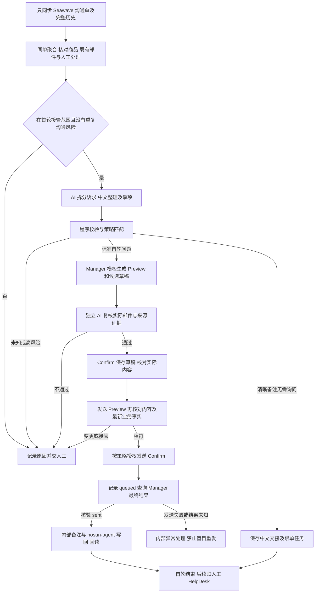

# Seawave「联系客户」一期实施计划

日期：2026-11-12；2026-11-13 收窄范围。状态：实施规格，尚未部署本场景工作流或启用邮件、沟通单写入。

**2026-11-13 当前工作范围：仅推进[多件确认首轮邮件](seawave-multi-dress-first-email.md)，以用户确认的多件处理策略为依据。ETA 冲突和 comment 的邮件、中文交接及相关写入全部暂停。** 下文保留原完整方案供后续参考，不将其列出的日期/备注场景加入当前开发和试点。客户回复继续交人工；发送优先采用 Gmail CLI。

**用户同日进一步确认的例外：** 首信必须告知订单当前暂停并要求 48 小时内回复；已核实的两件多件拦截在 48 小时无回复且无其它未决阻断/人工暂停时，允许按正常流程进入生产；三件及以上无回复仍暂停。内部超时处理不告知客户。该例外以多件专用规格为准，覆盖下文旧方案中“所有放行均人工”的通用表述；真实回复后的自动接续仍不在当前阶段，超时执行器尚未开发启用。

**同日发送通道补充：** 用户随后授权通过 Gmail CLI 向指定测试地址发送一封邮件，现已完成发送及 SENT 内容回查，见 [测试记录与简化路径](../runbooks/gmail-cli-customer-contact-test.md)。Gmail CLI 成为一期发送的优先实现方向，可以移除对 Manager 发送及待开发状态查询接口的依赖；模板/多语言来源、AI 内容复核、发送去重和 Console 写回仍需实现。下文 Manager 发送链路保留为已核查的备选契约，其接口补充不再是 Gmail 方案的开发前置条件。“不由 Gmail 发客户邮件”是本次测试前的原方案约束；后续 Gmail 正式发送以该补充及完整验收为准，当前未启用客户自动发送。

本计划落实用户最新确认：实际业务仅限 `console-new.seawavetech.com` 的 DressAfford / EllenBridals；MyDorris 仅供只读学习。邮件由各站 Manager Admin API 生成和发送，多语言由 Manager 负责。发送前的 review 是 API Preview 后的内容复核，**可由 AI 完成，不要求逐封人工审批**。客户反馈由同事在 HelpDesk 处理，一期止于首轮沟通与交接。

本文取代[早期通用方案](customer-contact-automation.md)和[MyDorris 历史设计](mydorris-customer-contact-phase-one.md)作为本项目的实施依据。历史研究仍有效，历史设计中的 MyDorris 自动化部署、回复后自动解除等范围不再适用。

## 1. 一期交付边界

| 对象 | 一期处理 | 完成判据 |
| --- | --- | --- |
| 多件新单 | 核实有效礼服清单，按标准模板询问是否全部需要 | 邮件发送结果可核验，首轮信息已写回并交人工接续 |
| 使用日期早于预计送达 | 核实日期口径，询问日期是否准确、最晚可接受日期 | 同上；不承诺提前到货 |
| 备注缺少可执行信息 | 识别缺项，在已批准的测量/长度等模板范围内询问 | 同上；未知设计或缺图片转人工 |
| 备注明确完整 | 整理中文要求、保留原文证据及商品映射，交跟单 | 中文交接和任务成功保存，不必额外发邮件 |
| 纯感谢等无业务要求 | 记录判断和依据，进入人工可快速核对队列 | 不多发确认信；不自动解除阻断 |
| 人工工厂问题、风险、取消退款、材料及制作能力判断 | 分类、整理依据和人工处理建议 | 跟单/客服队列可见且有下一负责人 |

一期不自动接续客户回复、不催信、不由 Gmail 发客户邮件、不通过 HelpDesk 发送真实邮件；本场景不自动 publish、release、done，也不执行订单修改、暂停、取消或退款。既有其他业务功能不受此计划改变。

**“可以发送首封邮件”与“可以解除订单阻断”分别授权。** 一期的自动通过是允许某封首信进入发送流程；订单解除仍由当前客服/跟单流程完成。此前讨论的“客户全部保留后自动解除”依赖回复处理，应放在后续阶段；纯礼貌备注的自动解除也暂留后续独立策略。

## 2. 已确认的系统与接口

2026-11-12 已用现有站点连接只读核对两站 Manager 文档及完整邮件模板列表，未调用任何 POST/PATCH：

| 站点 | Manager Admin API | 邮件模板总数 | 技术上可供智能邮件使用的启用手动模板 |
| --- | --- | ---: | ---: |
| DressAfford | `https://dad.seawavetech.com/api/admin` | 44 | 16 |
| EllenBridals | `https://ebd.seawavetech.com/api/admin` | 43 | 15 |

两份文档均为 `tradeManager Admin API 1.20.0`，内容哈希一致；[快照与契约缺口](../api/trade-manager/README.md)。现有模板不等于已批准策略：多件模板含固定客服名、固定询问活动日期和退货措辞；定制模板直接宣称可制作和不可退换，均需改造后使用。

已确认的接口约束：

- 模板新增/修改、草稿生成/修改、发送都使用 Preview → Confirm；Confirm 使用幂等键。
- 智能邮件只能使用 `category=template`、`status=1`、`is_auto=0` 的手动模板。API 名为手动模板不妨碍由受控工作流调用；不要设置 `is_auto=1`，也不要用 HTML 模板。
- Manager 创建/更新模板后异步生成已配置语言翻译。CSI 保存模板映射、版本/内容指纹和核验结果，不建立另一套多语言模板库。
- 发送 Confirm 只表示 `queued`，不等于发送成功，更不等于客户收件。
- 用户确认：AWS 邮件日志已入 Manager 数据库，当前没有状态查询 API，可由 Manager 项目补充。
- 当前公开文档也没有草稿 GET、审核队列或状态回调接口。不能把 Preview/Confirm 当作现成人工审核系统，也不能假设能查询最终状态。

## 3. 技术方案与责任

采用 **Laravel 保存业务状态并控制动作，n8n 编排固定流程，AI 理解和复核内容，Manager 负责模板、多语言及发送**。

| 组件 | 责任 |
| --- | --- |
| CSI / Laravel | 只同步 Seawave 业务队列；聚合、基线、人工接管、策略、去重、锁、版本、动作授权、调用 Manager、查询结果、写回 Console、审计 |
| n8n | 新增 `work/customer-contact-v1` 专用工作流；调用受限 AI 分析与独立复核，返回结构化结果；不长期挂起等待客户 |
| AI 分析 | 拆分全部诉求、原文证据、中文要求、缺项、场景及模板建议；不自行决定 API 目标或执行副作用 |
| AI 内容复核 | 检查 Manager 生成的实际主题/正文/语言、问题覆盖及政策边界；收件人归属由程序核验，模型上下文按需脱敏；最多修订一次，不通过转人工 |
| Manager | 站点隔离的模板/翻译、草稿生成、Preview/Confirm、发送队列、AWS 日志及新增状态查询 |
| 当前客服/跟单 | 在 HelpDesk 接续真实回复，处理复杂事项及解除；一期异常建议通过 CSI 队列查看 |

现有 Agent 可作为复杂事项的只读调查工具。一期发送分支用固定流程，避免由自由 Agent 自行扩展处理范围。Console/Manager Token 均留在服务端，不交给模型或 n8n 文本上下文。

## 4. 首轮端到端流程

生成 Preview 的候选稿与 Confirm 保存的实际稿、发送 Preview 返回的实际稿，均须内容一致；若 Manager 在任一阶段重新生成或被修改，原复核失效。发送 Confirm 应绑定已审核内容、目标收件人及当前草稿状态，服务端并发保障需联调验证。

一期不因看到 Gmail/HelpDesk 新来信而启动第二封。只读检查最新来信可用于**停止尚未执行的首信**和防重复；邮件发出后的客户理解、答复、催办及解除仍交给同事。

## 5. 可以自动通过首信的条件

以下条件全部成立，才允许 AI 复核通过后执行对应发送 Confirm：

1. 连接固定为 `seawave`，站点属于 DressAfford / EllenBridals，Manager 站点、客户、订单和当前商品均一致；收件人由订单来源核实，默认 CC/BCC 为空或批准白名单。
2. 是新单分配前的有效未完成事项，未取消、未发货，且没有人工接管、暂停处理、冲突或新的客户指令；订单/工单状态口径缺失时转人工。
3. 全部同单原因及必要历史已读完；按 `connection + sid + oid` 聚合，Service、补款、衣袋等不算礼服。不能按沟通单条数发信。
4. 只处理明确接管起点之后的新事项；旧记录、存在“已联系/草稿入队”等历史但未查清的订单进入人工基线核对，CSI 未查到邮件不构成“尚未发送”证据。
5. 命中已批准并启用的站点/场景策略和模板，多件、日期、备注全部诉求得到处理；多种原因使用已审核组合结构，一封整合，不能各发一封。
6. 商品清单、日期、数值/单位、目标部位及缺项有原始证据；ETA 使用预计送达而非预计发货；没有必要事实时不填猜测值。
7. Manager 目标语言及内容可核验，关键数值、否定、条件和不变项没有被翻译改变；只有英文模板查询不能证明所有译文已经可用。
8. 实际邮件通过程序校验及独立 AI 复核，不含未批准的退款、退货、折扣、交期或制作能力承诺；没有未经核实的“已暂停”“已通知工厂”等陈述。
9. 同一首轮动作无已生成在途草稿、queued、sending、sent、unknown；最新输入与审核快照一致，未出现人工改动或接管。
10. 对应动作和站点开关已在验收后启用，有稳定幂等键、状态查询和异常队列。模型自报置信度不能代替这些条件。

同单新增原因在首信发出前可重新合并审核；queued 或 sent 后新增原因交人工，不通过更换模板版本或指纹再自动发一封。

## 6. 数据、状态和防冲突

- 案件键：`connection + sid + oid`；事项保存 `contact_id`、版本及原文证据。当前业务入口仅允许 Seawave，MyDorris 不进入定时任务、写适配器、发送映射或自动策略作用域。
- 首轮标识：按订单和明确接管批次生成稳定 `first_round_id`，绑定批准时的事项集合。重新分析、模型/模板更新或重试不产生新的首轮。
- 邮件分别保存 `prepared / pending_ai_review / review_failed / approved_by_policy / draft_saved / queued / sending / sent / failed / unknown`；交接单独保存 `handoff_pending / handed_off / human_owned`，避免把交接或入队写成发送成功。
- 审计保存站点、案件、策略/模板/流程/模型版本、内容摘要哈希、草稿 ID、消息 ID、请求 ID、动作幂等键及实际审核证据。`authorized_by_policy` 如实记录，不伪造现有 ActionProposal 的人工审批。
- 发送前落库意图，按订单串行。Confirm 网络超时进入 unknown；先通过远端幂等结果或新增查询接口核对，不新建草稿、不换键、不直接重发。
- 发送成功而 Console 写回失败，只重试该写回，不能重发邮件。多个事项共享一个首轮发送 ID，各自只记录与其有关的问题。
- 两站分别配置发件身份、Reply-To、语言、签名和 Manager 模板 ID；不能因 ID 相同就互换。新邮件回复必须实测仍进入现有 Gmail → HelpDesk 路由。
- 首轮信息交接给当前客服/跟单队列，记录岗位/负责人和未决问题。没有唯一 HelpDesk Ticket 时使用本地任务及订单关联，不伪造 Ticket ID、不创建出站 HelpDesk 消息。

## 7. Console 写回约定

新增本场景专用、仅 Seawave 的编辑适配器。现有 MyDorris 只读保护继续保留，禁止通过通用 URL/连接参数绕开。

第一批字段为 `internal_note`、`recorder`；清晰备注另提供受控 `customer_requirement` 中文合并能力，须保留人工既有要求、映射到具体商品并独立验收。不把整封邮件或复杂制作指令塞进内部操作日志。

权限联调需分别核对 Manager 的 `email.read`、`email.write`、`email.send` 与写开关，以及 Seawave 的 `customer-contacts.view`、`customer-contacts.edit`、绑定内部账号权限及功能开关；当前模板 GET 成功仅证明读取可用。一期不申请本场景的 publish/release 权限。

- `recorder` 固定为 `nosun-agent`，API 真实审计 actor 仍为绑定内部账号。
- `internal_note` 按当前值追加简洁操作记录，含时间、首轮 ID、动作结果及下一处理方；已有内容不覆盖。达到 20,000 字上限时停止自动写回并转人工，完整审计留 CSI。
- queued、sent、failed、unknown 分别描述事实。示例：`[nosun-agent][FR-示例] 多件及日期首信已入队；Manager draft=示例ID，待核验发送结果。后续客户回复由人工 HelpDesk 跟进。` 只有查询证实后才追加“Manager 已发送”，不写“客户已收到”。
- 中文交接保留原文、数值、单位、测量基准、目标商品及未确认项；保存成功不表示工厂已接单、已发布制作要求或允许分配。
- 编辑使用最新 `version`、Preview/Confirm、理由与幂等键；冲突后重读并合并，不覆盖同事新增内容。回读字段和历史确认结果。
- 本阶段默认不自动改 Console `status`。Seawave 前端各状态口径和人工队列衔接验证后再单独决定，不能从 MyDorris 历史直接复制状态迁移。

## 8. Manager 需要配合的最小接口

建议由 Manager 增加以下**新契约**，路径仅为建议，当前不可调用：

1. `GET /emails/drafts/{draft_id}`：当前站点及 API 用户可见的实际草稿内容、收件人、模板/语言、内容版本或摘要、状态、message_id 及发送时间/错误。
2. 查询该草稿的发送证据，可合入上述详情或单独 `GET /emails/drafts/{draft_id}/delivery`：按草稿/发送尝试关联 AWS 日志，返回排队、提交邮件服务、投递到收件服务器、退信/拒收、投诉及最后日志时间；未有事件与查询失败分别返回。
3. 如现有幂等机制无法从草稿 ID 找回超时的创建结果，补充按外部动作键查询/恢复操作结果，或明确原请求原键重放的可恢复契约。

需保证站点/用户权限隔离及写入到 AWS message ID 的关联，不能仅按收件邮箱和时间猜测。不要把 AWS delivery 当成客户已阅读。发送 Preview/Confirm 对草稿内容的绑定、重复请求行为和异步失败语义需要联调验证。

**完整发送结果闭环依赖该接口；这不阻止同步、分类、模板、AI 审稿和中文交接先开发。** 在接口补齐前停在候选稿/可审稿结果，不能把 queued 作为一期成功验收。测试订单可先用人工日志核对联调，不据此开放无人值守正式发送。

模板公共变量规范由 Manager 文档引用的 `wiki/后台API/邮件模板公共变量规范.md` 提供；实际受支持变量及 `context` 的使用方式应在联调中核实，不假设本方案示意变量均可直接传入模板。

## 9. 按依赖顺序实施

| 顺序 / 交付包 | 本项目工作 | 依赖或配合 | 验收产物 |
| --- | --- | --- | --- |
| A. 作用域与基线 | 固定 Seawave、两站作用域；梳理当前未决事项、旧沟通及人工接管标记；历史首轮建立基线 | 客服确认试点接管起点及负责队列 | 无 MyDorris 业务动作，无历史重复首信的接管清单 |
| B. 聚合与状态 | 新增沟通单案件/事项映射、分页同步、执行日志、首轮唯一键、锁、重试和停机开关 | 现有只读 API 可继续使用 | 完整同单视图，Service 不误算，同单只产生一个首轮 |
| C. 策略与模板 | 先多件、日期、缺项澄清、明确备注交接；每站绑定独立模板和发件配置 | 用户补充常用实例、确认业务口径；Manager 变量规范 | 版本化策略与待发布模板，经业务确认后进入运行 |
| D. AI 与工作流 | 分析 schema、证据引用、中文核验、独立实际邮件复核、一次修订及人工异常 | B、C；现有 n8n/AI 设施 | 离线回放报告和可见的人工异常队列 |
| E. Manager 适配 | 模板/草稿生成及修改/发送的 Preview/Confirm；草稿一致性、幂等、状态对账 | Manager 补草稿/发送日志查询，与 C、D 可并行 | 测试收件人真实出站及结果核验，超时不重发 |
| F. Console 与交接 | 追加内部备注、nosun-agent、中文要求合并、回读、首轮结束和人工归属 | 字段编辑权限、Seawave 队列口径；B、D | 保留人工内容、版本冲突受控、后续不自动回复 |
| G. 影子运行 | 对独立订单回放、与同事处理对照，先不写不发；新单全流程只生成建议 | B 至 F；代表性样本 | 按场景统计正确性、漏项与人工转交原因 |
| H. 分站试点 | 测试邮箱验证 → DressAfford 多件首信限量启用 → 日期/缺项 → EllenBridals 单独验收 | E、G 通过；各站模板/路由可核验 | 逐单可追踪首轮、异常可停、HelpDesk 同事可接续 |

上线模式分为 shadow、自动草稿/AI 审核、按策略自动首信。常规邮件通过 AI 复核后可自动 Confirm；仅异常进入人工，不额外引入每封人工批准。初期建议每站每日最多 5 笔自动首信，观察后调整；这是上线限流建议，不是已启用参数。

## 10. 验收与第二阶段

首期至少覆盖：单多件、多件+配件、多件+日期、Service 数量展开、同单多原因、清晰与缺项备注、单位/鞋跟/长度基准、未知设计、人工接管、历史已联系、重复执行、两站同数字 ID、草稿内容变化、Queued/超时/退信、发送成功写回失败、Console 版本冲突以及客户在发送前已回复。

错客户、串站、重复首信、关键数值错误、遗漏未决问题和错误声称已发送均为上线阻断问题。每类先取得独立订单的业务标注与回放，再使用测试订单验证接口；小样本只能证明当前验收范围，不能宣称全业务可靠。新的规则、模板和关键模型/流程版本需重做对应验收。

第二阶段再经 HelpDesk API 建立回复识别、客服占用/接管、同线程答复、无回复提醒和实际发送验证；之后逐类评估解除条件及生产要求发布。不能绕到 Gmail 自动续信，也不能自动接管 MyDorris。

本次交付为计划、模板收集清单与 API 核查记录；未创建远端模板、草稿或真实邮件，未修改任何 Console 业务记录。
