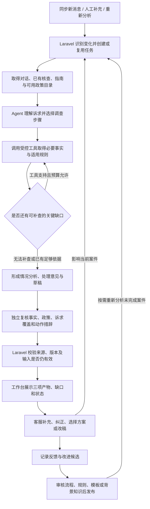

# Ticket 智能辅助：第一阶段实施方案

日期：2026-10-24。状态：首个实现已完成本地开发，待真实模型、队列及 WeKnora 实例验收。本文是当前实施优先级依据；自动发送属于后续阶段。

当前实现与运行方式见 [第一阶段运行手册](../runbooks/ticket-assistance-phase-one.md)。已接通三项产物展示、自动派工、个案反馈与修改历史、知识候选及审核后 WeKnora 同步/检索；本轮沿用 v2，SDK 替换调查节点仍按对照验收推进。

## 1. 目标与范围

在现有 Ticket 列表和详情基础上，自动形成可供客服直接使用的三项结果：情况分析、处理意见、邮件草稿。客服可以补充事实、纠正判断、选择处理方案并修改邮件，系统利用这些反馈重新调查和生成，同时积累可审核的流程、决策依据和背景知识。

第一阶段的完成条件是稳定辅助客服处理工作，衡量人工调查与改稿时间、事实正确性、诉求覆盖及建议可用性。自动发送率不作为本期指标。邮件发送和订单业务操作沿用现有人工处理方式。

不要求先补齐所有业务接口和政策。已支持事项正常产出，未支持事项明确缺口；用实际案件推动接口和知识补齐。阶段一不引入通用流程引擎、额外知识平台或复杂多 Agent 系统。

## 2. 每张 Ticket 的三项产物

| 产物 | 展示内容 | 证据边界 |
| --- | --- | --- |
| 情况分析 | 客户逐项诉求、沟通背景、当前阶段、已确认事实、争议与待确认信息、重要时限 | 区分客户说法、历史客服表述、人工补充和系统查询；关键事实有来源与查询时间 |
| 处理意见 | 首选方案及理由、适用规则、可选方案、必要核查、内部跟进、需要人工决定的具体问题 | 建议不代表已授权或已执行；适用规则与事实引用可展开查看 |
| 邮件草稿 | 对客户的可用正文，必要时另附内部协作草稿；覆盖本次诉求并匹配沟通阶段 | 只写已确认事实、适用政策及明确的个案决定；内部分析与客户正文分开展示 |

决策路径指可核对的“适用步骤、证据、规则、选择及缺口”。无需存储模型内部思维过程，也不以长篇推理代替证据。

不存在安全可用的实质回复时，也应保留前两项产物；第三项说明当前为何不能起草，或提供经过审核的必要澄清草稿。纯致谢、已约定等待资料等情况可以建议暂不回复，明确理由和后续安排，不强行生成邮件。

## 3. 标准处理流程

### 触发与去重

复用已有增量同步与 Laravel Queue。首次纳入处理范围的待处理 Ticket、新的客户公开消息和人工明确要求重新分析会创建工作；单纯定时扫描不得反复生成相同结果。人工补充改变事实或决定时使相关结果待更新。

输入指纹覆盖消息、身份与订单关联、人工指南、实际使用的政策和流程版本；先复用现有指纹，按实测再优化过宽的失效范围。任务记录租约和有界尝试次数；同范围相同输入只保留一个活动任务。模型运行期间到达新消息时，旧结果保留为历史，不展示为最新有效结果。

客服已回复后的内部或外部进展，初期由人工补充并触发；新工具或事件接入后再支持自动唤醒。不能因为最近一次公开消息来自客服，就永远无法准备后续通知。关闭案件和无关系统通知不无条件触发重跑。

### 调查和形成建议

Agent 负责一次案件内的理解、选择步骤、按需调查和建议组织。工具负责身份范围、读取权限、来源和结构化事实；模型不能用邮件内容改变工具授权。调查先利用仍有效的已有信息，缺什么再查什么；为每次运行设置时间、工具次数和模型预算。

业务流程提供各类事项的必要核查、分支条件、政策适用、例外、模板与转人工条件。流程可以逐步完善，不要求将每个客服判断预先编码为完整规则树。现有知识字段 action_steps、decision_tree、required_facts、reply_templates 和 escalation_rules 优先复用。

独立复核是固定步骤。新 Worker 接管调查时替换原 n8n 同职责节点；同一任务只能选择现有 v2 或新的候选路径，避免串接两套完整调查。首轮可以复用既有生成和复核，不因采用 SDK 就同时重写所有步骤。

### 缺口处理

| 缺口类型 | 当前案件怎样处理 | 后续怎样完善 |
| --- | --- | --- |
| 缺事实 | 写明缺哪个事实、影响哪项建议、由谁补充；必要时起草澄清邮件 | 人工补充或查询工具，注明来源与有效期 |
| 缺接口 | 明确需要的业务能力和当前替代调查方法 | 开发有范围校验的只读接口，使用相关案例验收 |
| 缺规则或决策依据 | 提供已知事实、选项、风险和需要负责人决定的问题 | 从个案归纳候选规则，经审核后发布 |
| 证据或规则冲突 | 展示冲突来源，限制受影响建议和声明 | 人工核对权威来源，修正规则或事实 |
| 技术失败 | 保留已取得的证据和运行状态，允许有界重试 | 修复接口或运行问题，不误报为业务无法处理 |

缺少一项判断依据不能隐去所有有效分析。缺口按具体诉求和声明标注；例如能解释在途状态但不能承诺到达日期。身份未确认时不展示受保护的订单事实，仍可说明待核验事项并准备安全的澄清。

## 4. 人工交互与持续改进

工作台按处理顺序展示三块主内容，技术轨迹和原始 JSON 放入可展开详情。列表展示待分析、运行中、可审核、需补资料或依据、失败、结果待更新，以及简要问题类型和紧急提示。

每项产物支持反馈：

- 情况分析：纠正事实、补充来源、指出遗漏诉求。
- 处理意见：接受、选择其他方案、指出政策不适用、填写当前个案决定。
- 邮件草稿：原样采用、编辑后采用、拒绝及原因。

前台可以保留一个自然语言补充框，附少量必要操作，不要求客服理解复杂 schema。系统记录修改前后的版本、操作人、时间和所针对的结果；原始模型产物不可被改稿覆盖到无法还原。

反馈先分清适用范围：

1. 当前案件事实：仅进入该案件的证据，保留来源和有效性。
2. 当前案件决定：作为本次方案依据，不当作业务动作已经执行，也不默认扩展到其他客户。
3. 模板或背景知识：形成候选内容，核对适用站点和来源后发布。
4. 流程或政策变化：附典型案件和影响范围，由负责人审核，回放验证后发布。

“不断完善”主要是更新版本化流程、政策、模板和案例；第一阶段不训练模型权重。人工修正可以即时帮助当前案件，未经审核不能自动变成全局规则。反馈从首个可用版本开始收集，候选归纳和批量复盘可以随后增强。

### WeKnora 文档维护与发布

用户明确要求将自动沉淀、文档整理和维护纳入流程。第一阶段采用“持续记录候选、按批次归纳、人工审核、自动发布和更新”的方式：Agent 对新增案件反馈进行去重归纳，比较已发布文档后提出新增或修订稿，附来源、适用范围、改动说明及待确认问题；审核人确认具体版本，Laravel 后台发布器才将该版本同步到 WeKnora。

已有 KnowledgeResearchSynthesizer、KnowledgeResearchFinding、KnowledgeResearchReport 和 KnowledgeArticleVersionPublisher 提供部分基础。现有归纳输入来自 Decision Case，需要增加当前工作台反馈与处理结果的衔接；现有本地发布也不等于 WeKnora 已同步。复用前统一经过版本审核的发布入口，避免旧归纳命令直接覆盖已发布内容。

维护按稳定的知识主题进行，不将每张 Ticket 自动变为正式文档。每次修订保留原文、差异、来源案例、人工反馈、适用站点与生效版本。人工审阅的来源可以含案件证据，但发往通用知识库的正文和元数据应清理个人信息及个案特批；修订期间旧的有效版本继续使用，已有文档被判定有误时及时停止其正式使用。

本地 WeKnora 源码已确认以下接口；实际部署版本、鉴权和索引行为在接入时验收：

- `POST /api/v1/knowledge-bases/{kb_id}/knowledge/manual`：提交 Markdown 文档。
- `PUT /api/v1/knowledge/manual/{knowledge_id}`：更新手工文档正文。
- `GET /api/v1/knowledge/{knowledge_id}`：查询文档及解析状态。
- `PUT /api/v1/knowledge/{knowledge_id}`：更新标题、描述和元数据，不是正文更新接口。
- `DELETE /api/v1/knowledge/{knowledge_id}`：撤回文档；首次接入先实现受控停用和必要撤回，不开放批量清库。
- `POST /api/v1/knowledge-search`：验证检索命中并供案件调查使用。

发布器记录本地 article_key、已审核版本、content_hash、目标知识库、远端 knowledge_id 和同步状态。重复发布相同版本不新增副本；检测旧版本并发覆盖，超时先查询远端状态再重试。接口写入成功后继续检查解析和实际检索结果；只有内容与版本正确且可检索，才标记同步完成。正文更新是否存在暂时检索空窗需以实际版本验证，未验证前不承诺无中断替换。

客服调查运行只持有检索能力；后台发布器持有限定目标库的写入能力，凭据不进入模型上下文。Agent 可以自动生成并保存候选文档，人工审核通过后由程序自动上传和更新。若需在 WeKnora 浏览未审核候选，应使用独立候选库，正式检索不包含该库；初期将候选留在客服系统可减少同步和审核复杂度。

首轮验收闭环：同一知识主题的若干人工纠正被归纳成一份修订候选，审核后更新对应 WeKnora 文档；重复同步不产生副本，检索返回正确版本，新案件能引用该修订，驳回稿不生效。批次频率先支持手动触发，运行稳定后再配置定时，不在规划阶段直接创建周期任务。

## 5. 组件分工与现有代码衔接

| 组件 | 第一期职责 | 复用或调整位置 |
| --- | --- | --- |
| Laravel 工作中心 | 同步触发、任务、上下文、身份、输入版本、结果保存、人工反馈、权限与审计 | Conversation、Case、WorkItem、Draft、TicketRuntimeContext、TicketDraftInput、lease |
| Agent Worker | 理解诉求、调查工具选择、处理意见及候选内容 | 在现有 Agents SDK 实验基础上扩展受支持业务和工具；不保留物流报告作为第三条独立正式链路 |
| 固定流程 / n8n | 已有生成、审核修订或其他确定功能步骤 | 现有 v2 作为基线；调查职责被接管时明确删除对应重复步骤 |
| 知识服务 | 按站点和用途提供已审核规则、步骤、模板与参考知识 | KnowledgeArticle、bindings、版本和现有发布机制 |
| 工作台 | 情况分析、处理意见、草稿、补充及审核 | 现有 Ticket 列表和详情扩展，不先重建 UI 技术栈 |

当前 reply_plan 已有 answer_units、case_progress、internal_followups，Draft 已有审核入口，应映射到三项产物并补足缺失信息。优先存放于现有 WorkItem.result 和 Draft 元数据；只对需要独立生命周期、检索或审核的实体新增存储，不一次建设通用规则引擎。

现有草稿审核不足以覆盖“分析正确、建议错误”这类反馈，应补足分析和建议的反馈入口及原始版本保留。案件处理反馈与全局知识候选分别保存，避免同一条备注兼任事实、授权和政策。

## 6. 开发顺序及验证

| 步骤 | 交付 | 验证 |
| --- | --- | --- |
| 1. 统一三项结果 | 从当前 v2 结果映射情况分析、处理意见、草稿，补齐来源和状态；明确缺口 | 物流、生产、售后及资料更新案例，检查诉求覆盖、来源与建议阶段 |
| 2. 自动派工和展示 | 同步后自动创建候选任务、队列执行、最新结果和过期提示 | 重复同步不重复生成、新消息使旧结果失效、失败可恢复、无需逐封点击启动 |
| 3. 接通人工交互 | 补充事实、当前决定、纠正分析和改稿，保存版本并重新分析 | 个案决定不外溢、已回复后的后续进展能进入处理、旧结果和修改可还原 |
| 4. 提升调查能力 | 将 Agent 调查作为候选替换同等节点，按高频缺口增加接口和步骤 | 与相同冻结案例的 v2 对照；检查遗漏、错误、耗时和成本，已有功能回归 |
| 5. 固化改进循环 | 从实际反馈生成流程、规则或模板候选，审核发布及回放 | 候选有案例来源、未经审核不生效、版本可回滚、使用新规则的结果可追溯 |

步骤 1 到 3 构成首个业务可用版本；步骤 4、5 持续完善。接口或证据缺口若直接阻断首批案例，可在对应步骤中补齐，不等所有业务都具备完整接口。

## 7. 首轮验收案例与指标

用真实业务分布建立固定案例集，同时补充以下关键边界：常规在途查询、已签收未收到、生产进度、取消及退款混合请求、损坏但缺附件证据、人工特批、重复消息、等待客户资料、已有客服回复后的新进展、接口失败、新消息导致结果过期。

检查三项产物分别是否正确和可用，记录人工实际需要补充的证据与编辑时间；模型引用存在还需人工核实结论是否得到支持。保留未解决缺口，不把模型成功返回或草稿“采用”视为问题已解决。

阶段指标：有效分析覆盖、处理建议接受及纠正原因、草稿原样或编辑采用、关键事实错误、诉求遗漏、错误承诺、人工调查与改稿分钟数、整案时延和成本、反馈后同类问题改善。首轮先建立基线再定发布阈值，不未经测量承诺百分比。

技术回归覆盖：无自动发送和业务写入、范围与身份隔离、政策版本、证据过期、队列去重与恢复、并发新消息、反馈范围、原始版本保留、原有 v2 草稿和审核行为。真实模型、人工验收、线上发布分别记录。
