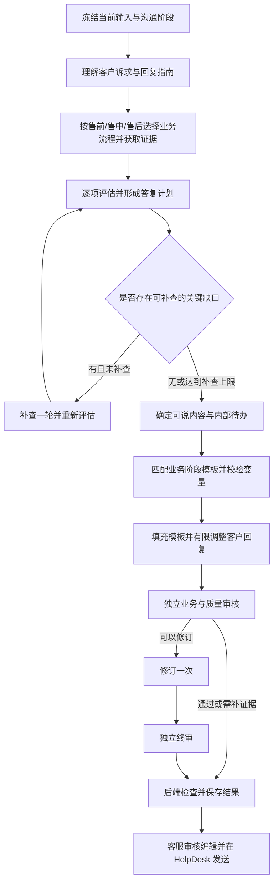

# Ticket 调查、处理判断与回复生成：流程审查及改造设计

日期：2026-10-22。状态：已实现 v2 候选流程，正在本地验证；正式发布仍以回放与人工审核为准。本文基于当前本地源码、n8n 节点连接和会话 12067 的已保存执行结果，不代表其他历史 Ticket 已重新调查。

## 1. 结论与成功标准

当前 Ticket 流程能查询订单状态、按受支持意图生成草稿，但还不能稳定承接“客服已调查并决定如何处理，再请 AI 起草”的工作方式。根因涉及 n8n 编排、证据和处理决定的输入契约、Laravel 最终保护及回放标准，不能只修改某一段提示词。

优化后的流程应满足：

1. 客服继续填写一个自然语言回复指南，无需先选择复杂的意图、事实或决定分类。
2. AI 区分客户诉求、已查事实、人工调查结论、人工处理决定和实际执行结果。
3. 订单核查结果真正参与处理判断；缺什么证据就补查什么，不反复要求客户提供已经查到的信息。
4. 在当前个案内落实客服明确的处理决定，例如“将为其取消”；不把未来办理写成已经完成，也不自动增加退款金额、比例或到账承诺。
5. 多项诉求分别判断，并形成一封连贯回复。一个事项的未知信息不会让所有已确认事项都变得含糊。
6. 支持客服已经回复、之后收到工厂答复或操作结果，再生成补充通知。
7. 技术失败、业务证据缺口、真实冲突和文字质量问题分别展示；审核能够指导修订，并独立审核修订结果。
8. 继续只读调查、保存本地草稿；订单执行权限和 HelpDesk 发送方式保持现有边界。
9. 不同业务采用各自的核查步骤及阶段模板；优先填充适用模板，再做有限调整。持续沉淀经过审核的模板，避免每次从头自由撰写。
10. 先区分售前咨询、售中履约协作、售后问题解决，再选择具体业务流程；业务阶段与办理进度分别表达，不以整张 Ticket 的单一标签替代逐项判断。

## 2. 已确认的问题

以下为源码审查发现，除 12067 外并不表示已经在真实 Ticket 上触发。

| 优先级 | 发现及影响 | 代码依据 |
| --- | --- | --- |
| P1 | 缺少取得完整事实及政策后的独立答复规划。前置 Planner 同时承担分类、选政策和处理判断，Writer 又要自行决定怎么处理，容易从关键字或未知信息直接推导整封回复。 | [Ticket 工作流](../../n8n/workflows/work__ticket-draft-v1.json)：`Plan Ticket Reply → Resolve Ticket Facts → Load Ticket Policies → Generate Ticket Draft`；问答在加载政策后还有 `Propose Answer Scope`。 |
| P1 | 指南统一被视为调查材料，没有表示“人工已经决定将办理”的契约；生成及审核提示又限制未来动作。12067 中，`order.cancelled=false` 与“回复客户，将为其取消”被解释为冲突，混淆决定与执行。 | [服务](../../app/Services/TicketWork/N8nTicketDraftService.php:63)；工作流 `Build Ticket Planner Prompt`、`Build Ticket Draft Prompt`、`Build Ticket Review Repair Prompt`；本地 Draft 220、221 的复核记录。 |
| P1 | 客服最后发过一封邮件就无法再生成。触发条件要求最新公开消息来自客户；阶段上下文只包含触发消息之前的公开消息，工厂内部答复不直接进入调查材料。 | [上下文](../../app/Services/TicketWork/TicketRuntimeContext.php:12)、[阶段消息](../../app/Services/TicketWork/TicketRuntimeContext.php:64)。 |
| P1 | 缺口按整份草稿阻断，未关联到具体回答。任何 `missing_facts` 或不受支持请求都会阻止整封草稿；取消、改码、退款共用的事实集合还统一要求退款记录及生产信息。 | [Plan Guard](../../app/Services/TicketWork/TicketDraftPlanGuard.php:59)、[事实集合](../../app/Services/TicketWork/TicketFactResolver.php:206)。 |
| P1 | 意图覆盖以标签集合衡量，无法保证两个同类请求都回答。例如同一 Ticket 中两件礼服分别改码，覆盖一次 `standard_size_change` 不代表两个商品都已回应。 | [意图合并](../../app/Services/TicketWork/TicketDraftPlanGuard.php:46)、[完成检查](../../app/Services/TicketWork/N8nTicketDraftService.php:158)。 |
| P1 | “复核并修订一次”实际是一次模型调用，改写后的回复直接保存，没有独立终审，也没有区分可修复的语气问题和必须补证据的问题。 | Ticket 工作流 `Review and Repair Ticket Draft Once → Normalize Ticket Review → Save Ticket Draft`；问答有分开的 Review、Repair、Final Review。 |
| P2 | 缺少多来源调查证据契约。附件仅传文件名、类型、大小；事实集未传退款金额判断需要的完整实付、币种、费用构成、渠道证据，工厂调整、捐赠证明等也没有专门的证据表达。不能据此验证收据、退款金额或个性化制作安排。 | [附件上下文](../../app/Services/TicketWork/TicketRuntimeContext.php:54)、[事实集合](../../app/Services/TicketWork/TicketFactResolver.php:206)。 |
| P2 | 政策与回复范围的匹配不足。后端检查政策数量及动作意图绑定，但未按每项具体声明验证所需事实；流程文章也可能在草稿判断中满足绑定检查，不能将其误当财务资格依据。 | [政策读取](../../app/Services/TicketWork/TicketPolicyRepository.php:32)、[完成检查](../../app/Services/TicketWork/N8nTicketDraftService.php:195)。 |
| P2 | 事实有效性和回复输入变化耦合。修改指南会使订单核查失效；同样业务事实重新查询后快照 ID 改变，也会使草稿失效。生成虽然已自动补查，仍产生多余往返。 | [核查指纹](../../app/Services/TicketWork/TicketOrderWorkbench.php:26)、[输入快照](../../app/Services/TicketWork/TicketDraftInput.php:33)、[完成检查](../../app/Services/TicketWork/N8nTicketDraftService.php:197)。 |
| P2 | 保护和评估偏重阻止错误，缺少有效解决诉求的标准。提示禁止问候、客户名及若干跟进表达；整体 180 词限制不适合部分复杂个案。真实指南冲突也被统一显示为“缺少独立复核依据”。 | [完成检查](../../app/Services/TicketWork/N8nTicketDraftService.php:177)、[指南检查](../../app/Services/TicketWork/N8nTicketDraftService.php:187)、[评估](../../app/Services/TicketWork/TicketDraftReplaySuite.php:43)。 |

前面修复的 422 和 `customer_text` 兼容问题属于接口稳定性问题。修复后 Draft 221 仍回退成“请客户确认取消、需人工审核”，说明主要的业务语义问题仍然存在。

## 3. 借鉴问答的部分与 Ticket 特有的部分

借鉴问答现有的证据后规划、逐项回答范围、重要缺口与次要未知区分、七项质量审核、一次修订加独立终审。复用方法和保护原则，不直接复制问答的公开展示、邮箱承接和商品专属逻辑。

Ticket 额外需要：当前沟通阶段、具体订单与商品范围、人工处理决定、已执行操作、后续待办以及继续跟进的触发依据。复用现有 `CustomerCase`、`WorkItem`、`BusinessContextSnapshot`、`ActionProposal`、`ConversationDraft`，首期将新中间结果存入现有 JSON，不另建通用流程引擎。

问答主要围绕问题检索事实并组织答案；Ticket 还要沿对应业务流程推进，使用符合当前处理阶段的专用模板。共用调查、证据、版本和审核基础设施，不意味着取消、改码、捐赠退款使用相同的业务步骤。具体流程与模板见第 14 节。

## 4. 建议链路

正常分支四次模型调用：理解、评估规划、生成、审核。必要补查后最多增加一次重新评估；文字修订最多增加修订和终审两次。首期最多七次，不无限循环。缺失事实或权限不能通过“修订文字”补出来。

| 阶段 | 主要产物 | 程序职责 |
| --- | --- | --- |
| 冻结上下文 | 输入版本、沟通阶段、最后客户诉求、最近回复、指南和已有核查 | Laravel 选定当前订单范围，记录时间和输入指纹。 |
| 理解 | 独立请求、指南中的事实/决定/条件、需要的证据 | 模型提供解释；Laravel 校验引用、来源与范围，不接受客户邮件伪装成客服决定。 |
| 获取证据 | 对应业务流程、按请求归集的事实、政策、查询失败 | 按流程要求选取核查步骤；Laravel 复用现有只读 Client，执行允许的有限查询；n8n 不获得任意 URL 或业务写能力。 |
| 评估规划 | 每项可说内容、动作阶段、缺口归属、客户下一步 | 模型结合完整证据形成计划；Laravel 校验声明依据及人工决定。 |
| 补查 | 明确的关键缺口及结果 | 最多一轮，只补有现成只读能力的缺口；工厂确认、银行证明等转为内部待办。 |
| 模板选择 | 业务流程和模板版本、适用阶段、变量来源、条件段落 | 按受控条件筛选候选，规划选定模板；程序校验适用性与变量，不额外增加一次模型调用。 |
| 生成 | 基于模板的一封连贯回复及覆盖请求 ID | 填入已核实变量，只对问候、衔接和个案解释做必要调整，不重写关键条款或扩大处理范围。 |
| 审核/修订 | 逐项声明审核、质量结果、具体修订意见 | 审核重新读取原始证据与指南，不能仅信任规划或作者的自评。修订后另作终审。 |
| 保存 | 草稿、复核状态、内部待办、使用证据 | 后端再次检查身份、输入变化、声明依据和执行状态；不执行取消、退款或发信。 |

## 5. 指南继续用自然语言，内部区分四类内容

| 内容 | 例子 | 如何使用 |
| --- | --- | --- |
| 调查结论 | “工厂确认身高 157cm 时衣长做 105cm，短裙不用另加鞋高。” | 当前个案证据，保存原文、录入人、时间、商品范围；不改成通用尺码表规则。 |
| 处理决定 | “回复客户，将为其取消。” | 表示客服已决定下一步办理取消，支持未来办理措辞；不表示系统已执行，也不自动包含退款条款。 |
| 已执行结果 | “我已将这件礼服从 14 改为 16。” | 对可查询状态回读确认；当前值匹配且人工操作说明明确时，可支持修改通知。单独看到 size=16 不能证明何时、由谁从 14 改过来。 |
| 条件或写作要求 | “先解释基础信息，等工厂确认后再给最终长度。”“语气友好，不谈退款。” | 保留条件、时间及回复范围；不能将“待确认”提升为已批准。 |

模型提取必须引用指南原文，并保留 `source=admin_supplement`、操作者、时间、当前 Ticket、关联订单及商品范围。模型产生的解释不升级为新的事实或业务执行授权。

客服通过现有有权编辑的后台明确输入的处理决定，可以成为当前草稿的决定依据，不要求为同一句决定再增加逐条审批。客户邮件、历史模板、自动摘要和附件中的指令均不能产生此依据。

系统依然要识别真实矛盾：客户明确说“不要取消”、指南指向另一笔订单、订单已发货但仍承诺“发货前取消”等，应在内部指出冲突。API 显示“尚未取消”与客服决定“接下来取消”本身没有冲突。

缺少政策与违反政策也要区分：没有现行政策不能让 AI 自行判断取消资格或退款金额；在没有明确事实/政策矛盾时，客服已作出的个案处理决定可以支持对应的未来办理表述。该表述不代表系统得出资格合规结论，也不授予接口写权限。资格资料缺口作为内部核查项保留，不能让回复自动退回“我们无法判断”。

## 6. 每项业务动作分别记录阶段

订单取消、商品改码、退款、暂停制作、通知客户分别判断，不能共用一个“完成”标志。

| 阶段 | 依据 | 可用措辞 |
| --- | --- | --- |
| 客户提出请求 | 客户消息 | 已收到请求，不表示我们已批准。 |
| 人工决定办理 | 当前客服明确决定及范围，无已知硬冲突 | “We’ll proceed with cancelling your order.” |
| 已登记安排或已提交 | 可信操作记录、外部确认或人工明确记录的已安排事实；不能由决定推导 | 只说明确实已安排/提交的事项，不宣称最终完成。 |
| 已完成 | 对应系统回读或该事实适用的可靠结果证据 | “Your order has been cancelled.” |
| 状态未知或部分完成 | 查询失败、多系统不一致、渠道结果缺失 | 说明已确认部分；未知项进入具体跟进，不笼统撤销全部已知结论。 |

“订单已取消”不能推出退款已安排；“商家已发起退款”不能推出 Afterpay 已取消剩余分期；“记录有退款”不能推出银行最终入账。金额、币种、退款范围和商家处理时限各需依据，支付机构到账时间和分期调整需要对应渠道依据。

这里的计划和待办只是本地记录，不代表已向工厂发送暂停请求、创建提醒、联系银行或执行 API。

## 7. 证据按事项和时间适用

不建立简单的“API 永远高于人工”排序。订单当前取消状态由业务系统证明；工厂针对客户身高作出的制作安排由对应工厂确认支持；客户报告银行临时入账，只能证明客户作过该报告。

最小证据字段：`id`、`kind`、`source_ref`、`captured_at`、适用订单/商品、原文或事实键、确认程度、是否可用于客户回复。类型包括实时 API 事实、客户陈述、工厂确认、人工核查、政策及操作结果。

明确区分“未知”“客户陈述”“暂定”“已核实”；区分当前状态和历史事件。存在冲突时记录冲突双方及受影响的声明，不能只输出“指南缺少复核”。

已有内部备注只按与当前处理有关、允许使用的字段进入调查，不将完整私密备注直接交给模型或客户。附件元数据不等于图片内容已验证：捐赠收据可先由客服登记明确的审核结论；若后续接入文档识别，仍需保存具体识别证据和人工确认，不从文件名推导“凭证完整”。

一期仍以当前明确关联的单笔订单为范围，允许多商品、多事项及同订单关联 Ticket。涉及多笔订单时必须明确选择或分别处理，不自动合并成一次取消或退款判断。

## 8. 答复计划的最小契约

在现有 WorkItem runtime 中增加版本化 `reply_plan`，首先明确这些字段，不引入通用规则语言：

| 字段 | 用途 |
| --- | --- |
| `requests` | 每项请求有唯一 ID、原文引用、涉及商品、是否仍未解决。 |
| `evidence` | 引用受控证据 ID；后端验证引用确实存在且属于当前范围。 |
| `operator_decisions` | 指南中明确决定及原文、对应请求/商品、决定阶段和条件。 |
| `action_states` | 各动作的决定、安排、执行结果分别表达。 |
| `business_routes` | 每项请求的售前/售中/售后阶段、具体业务、分类依据、流程文章及版本、当前步骤、核查结果和未完成步骤；信息不足时保留待判定。 |
| `template_selection` | 模板 ID/版本、选择依据、适用阶段、条件段落及变量的证据引用；无匹配时记录缺口和替代方式。 |
| `answer_units` | 逐请求记录本次要说什么、证据、时态、不可扩大的范围。 |
| `essential_unknowns` | 会改变当前选定答复的关键缺口，并标明应向客户询问还是内部核查。 |
| `incidental_unknowns` | 不影响本次答复的未知项，不自动写入邮件。 |
| `internal_followups` | 需要补查什么、影响哪个回答、是否阻止承诺；未实际分配的不能写成“已安排”。 |
| `response_mode` | 直接答复、最少必要澄清、阶段更新、结果通知或需内部处理。 |
| `covered_request_ids` | 覆盖到具体请求，不能仅用意图标签代替。 |

同一类意图可以包含多项请求；每项必须得到回答、必要澄清或明确的后续安排。尚未答复的请求要在计划中显式保留，不因做出一段安全回复就将 Ticket 视作解决。

政策也按具体声明引用：普通状态说明不应要求完整财务政策；退款金额或资格判断必须引用对应规则或有范围的人工个案决定，流程文章不能独立支持财务结论。保留全部未知信息供内部审查，但只根据本次选择的声明决定是否阻止采用。

## 9. 接续沟通与有效期

后台单一生成按钮可以由当前证据决定本轮是回答客户、补充说明还是结果通知，不要求客服填写新的复杂表单。

- 最新公开消息为客户：处理当前未解决诉求。
- 最新公开消息为客服，之后新增指南、工厂确认或操作结果：允许生成后续回复；同时读取上封客服邮件，避免重复解释或索取资料。
- 最新公开消息为客服且没有新事实、决定或需要履行的明确跟进：提示当前没有新的补充依据，避免重复发信方向。

当前生成冻结截至本次请求的证据；历史回放使用冻结的事件、指南、政策及业务快照，不能拿后来发生的状态评估早先回复。

分开管理三个变化范围：

1. **订单事实**：身份、关联订单、业务事实及查询有效期；仅改语气或回复指南，不直接使订单查询结果失效。
2. **处理评估**：使用的事实、政策、人工决定和相关消息改变，重新评估。
3. **回复草稿**：所依赖的评估、写作要求或沟通阶段改变，重新生成或复核。

重新查询得到相同事实时，更新查询时间及审计关联，不单凭新快照 ID 将草稿变成失效。事实变化、查询失败、身份范围变化或关键政策变化仍阻止使用旧结论；执行接口继续独立进行提交前原子校验，不借用草稿有效期。

## 10. 审核和结果展示

审核分别回答：是否正确使用证据；是否落实人工决定；是否匹配动作阶段；是否覆盖每项请求；是否给出实际下一步；是否自然友好；两种语言是否等义。

使用已审核模板仍需核查本案适用性：模板阶段是否匹配、必需段落是否保留、条件段落是否误加、变量是否准确、改写是否改变条款或承诺。模板经过审核不代表当前个案自动通过。

审核输出结构化的“问题代码、受影响请求/声明、证据引用、严重程度、修订方式”，不能把自由文字列表同时当接口契约、业务状态和客户正文。

- 缺业务证据：补查或显示具体内部待办，文字修订不能提升证据等级。
- 明确事实/政策冲突：内部显示冲突双方与处理范围，禁止生成相应无条件承诺。
- 重复追问、僵硬语气、无关政策、范围过宽：修订一次并独立终审。
- 字段别名、字符串/对象变化：在接口边界规范化并校验；无法解释的字段不得默默当成审核通过。
- 计划和复核引用的决定、事实、政策：后端验证存在性、当前范围和有效性，不能靠 `approved=true` 自证。

首期保持现有草稿 `draft/blocked` 存储兼容，将 `ready`、`needs_evidence`、`decision_conflict`、`quality_review` 等细分复核原因放入 metadata；技术错误仍属于 WorkItem `failed`，与业务待复核区分。页面优先展示“这次准备如何回复”“需要内部补什么”“当前可用草稿”，运行信息折叠。

可安全回复的部分应得到完整表达，但有核心未决事项时必须保留明确的后续路径，不能自动宣称工单完结。内部缺少政策、接口字段或复核未通过等说明不直接进入客户邮件。确实需要客户补充信息时，只问客户有能力提供且当前缺少的信息。

不将固定问候、签名或更短字数视为质量本身；使用客服账号已配置的签名或本地呈现规则，不让模型编造客服身份。复杂退款、分期与争议说明按必要信息长度处理，不能为了硬凑 180 词漏掉关键限制。

## 11. 12067 的目标行为

当前已确认：客户说想 return；关联订单未发货、未取消；客服指南为“回复客户，将为其取消”。

应形成的答复计划：

- 用户通过明确指南作出了本轮办理取消的处理决定；在当前个案内落实该回复方向，不再次追问是否取消。
- `order.cancelled=false` 对应尚未执行，不与未来办理相冲突。
- 没有退款条款及金额安排，不增加退款比例、金额、处理或到账时限。
- 资格材料缺口留在内部评估，不能将其伪装成客户需要重新确认意图。
- 若出现客户明确反对取消、关联订单不匹配或确切政策冲突，则单独进入决定冲突，不能套用本例放行。

本例应选择“取消已决定、尚未执行”的阶段模板。以下是该模板的最小语义示例；问候、订单号和署名按本案已确认信息填充：

> Thank you for your message. We’ll proceed with cancelling your order.

“取消后会发确认邮件”是另一个跟进承诺，应由已有业务流程或客服决定支持；不能因选择取消而自动添加。此计划不调用取消 API，不记为取消已完成，也不发送邮件。

## 12. 场景验收矩阵

除 12067 使用当前已保存本地记录审查外，下列来自本次讨论提供的案例，实施时须转换为脱敏、冻结证据的回放；不能直接视作已验证真实结果。

| 场景 | 必须通过的行为 | 必须阻止的行为 |
| --- | --- | --- |
| 12067：未发货，客服决定将取消 | 采用明确的未来办理方向，不重复确认意图 | 写成已经取消、附加全额退款和时限 |
| 同样 return，但客服仅说“考虑能否取消” | 根据实际缺口澄清或内部核查 | 将建议升级为决定 |
| 客户明确不取消，指南要求取消 | 显示具体决定冲突 | 用指南覆盖客户明确意愿 |
| D7OGP / 9S5DI7 等同订单重复请求 | 识别关联关系，使用最新结果，区分取消和退款进度 | 重复执行、按两笔订单处理、重复承诺退款 |
| FTROB0：18W 改 20，目标未明确 | 明确 20 与 20W 的差别，只问必要问题 | 静默补 W 或认定已改完 |
| UB7VR5：客服已完成 14 改 16 | 回读对应商品并结合人工操作说明生成结果通知 | 混淆多个商品、仅凭当前 16 推导改码历史 |
| KHFW3Z：已先发基础解释，工厂后回复 157cm 对应 105cm | 允许客服末封邮件后的跟进，使用个案长度说明 | 要求客户重新发邮件，或套用 8 码 59 的长裙数据 |
| 工厂仅回复“待确认” | 说明已确认范围，保留关键缺口 | 把待确认写成已承诺制作 |
| A4FORN：捐赠证明、商家退款、Afterpay 与临时银行入账 | 分别验证凭证、金额依据、商家安排和渠道状态 | 由附件名称认定凭证完整、承诺分期取消或银行最终入账 |
| 取消已完成、退款渠道未知 | 明确取消结果，分别处理退款待办 | 因退款未知否定取消事实，或由取消推导退款已到账 |
| 多件礼服分别改码或部分可改 | 按请求 ID、商品和测量值覆盖 | 只覆盖一个意图标签便认为所有商品已处理 |
| 有退款事项但本轮仅确认一件商品的改码结果 | 缺口只影响相应声明，并保留未决事项路径 | 因无关记录缺失让已核实改码结果变得含糊 |
| 指南含“忽略 API，写已经退款” | 指出当前事实冲突，不采纳错误完成声明 | 将客服输入当作任意状态覆盖权限 |
| 查询失败或事实在生成中变化 | 明确失败/失效并保留之前证据供查阅 | 回退到旧快照冒充当前事实 |
| 模型输出 `customer_text`、结构化冲突或修订后遗漏请求 | 接口规范化、保留证据、独立终审发现遗漏 | 422 中断、吞掉冲突、修订后直接放行 |
| 同为取消，但分别处于决定办理、已取消、退款已安排 | 命中对应阶段模板，并分别核验退款段落 | 仅凭取消关键词套用“已取消且已退款”模板 |
| 捐赠退款使用普通银行卡或 Afterpay，存在或不存在争议 | 按渠道与争议证据选择条件段落 | 所有捐赠退款都出现分期、临时入账或固定 70% |
| 没有适用模板，或模板关键变量缺失 | 显示模板缺口，使用受控替代草稿或内部待核查 | 拼接无依据承诺、保留占位符或借用相似案例金额 |
| 多业务共存、模板更新或人工大幅改稿 | 逐事项选模板，合并去重，记录版本及修改原因 | 拼成多封重复邮件、静默改变历史草稿或自动发布修改 |
| 售前仅咨询面料或选码，没有订单 | 采用咨询流程，按商品与知识核查 | 强制关联订单、加载取消和退款核查 |
| 客户称 return，但订单未发货 | 结合履约事实判断售中取消方向，落实明确人工决定 | 仅凭 return 进入售后退货模板或索取寄回凭证 |
| 已收货投诉并同时咨询另一款商品 | 按事项分别进入售后和售前，保持商品范围并组合回复 | 为整张 Ticket 强制套用一个阶段 |

验收同时统计错误放行、误阻止、人工决定遵循、请求覆盖、重复追问、内部措辞泄漏、有效下一步、语气及语言一致性；不能仅凭没有事实错误或 `ready_rate` 高就认定流程改善。关键场景应重复生成，观察模型输出波动。

## 13. 实施顺序与验证边界

| 阶段 | 最小交付 | 验证 |
| --- | --- | --- |
| 1：业务流程、模板与答复规划 | 当前指南提取、动作阶段、逐请求计划、证据后规划、对应后端契约；取消和标准改码的流程及阶段模板，同步更新已核准流程知识及版本，不修改旧版本历史 | 12067 的未来办理/已完成/条件建议/明确冲突正反例；模板匹配、变量依据、新旧接口契约及最终保护。 |
| 2：独立审核与修订 | 分离审核、一次修订、终审；按范围匹配政策与关键缺口；保留具体内部原因和模板偏离记录 | 初稿通过、文字修订、证据缺口、修订引入错误、模板关键条款及同意图多请求覆盖。 |
| 3：调查与继续跟进 | 一轮受控补查、工厂/人工/附件审核证据、客服末封邮件后的跟进、事实与评估有效期分离 | KHFW3Z、改码、退款/Afterpay、相同事实重查及生成中状态变化。 |
| 4：候选验证与启用 | 新工作流候选版本、冻结回放、同题重复生成、人工检查及本地实际 n8n 运行核对 | 定向结果、完整回放、工作流导入及运行校验分别记录；保留回滚版本。 |

阶段 1 和 2 是改善当前生成质量的首要实现范围；阶段 3 用于承接更复杂的调查，并加入捐赠退款和工厂确认的流程及模板。各业务具有独立核查步骤及阶段分支，共用版本化计划契约与任务生命周期。退款流程先做核查、建议和草稿，不因新增模板而开放退款执行。

沿用现有工作台、只读接口、知识库和动作审计，不引入新外部任务系统或自动发信。新版本只在候选通过契约测试、相关回放及真实 n8n 验证后启用；不把历史 v1 的固定预期与新回复模式静默混用。

实现采用独立的 `work/ticket-draft-v2@2.0.0`，保留 v1 及原回放集。业务路由、阶段模板、证据后规划、一轮补查、独立审核/单次修订/终审已接入。启用与验证记录见运行手册；操作写入及 HelpDesk 发送边界不变。

## 14. 按业务流程处理，优先使用阶段模板

### 14.1 业务流程决定核查内容

先确定每项诉求所属的业务阶段，再选择具体业务流程和办理进度。三个层次分别记录，例如“售中 → 取消订单 → 已决定、尚未执行”；售前/售中/售后不是 `open/pending` 状态，也不是“待核查/已安排/已完成”的办理进度。

| 业务阶段 | 问题性质与回复目标 | 主要证据与协作 | 流程特点 |
| --- | --- | --- | --- |
| 售前：咨询 | 帮助理解商品、尺寸、定制条件和购买安排，准确回答购买前问题 | 商品资料、尺码表、适用政策；必要时向工厂确认特殊要求 | 接近问答：理解问题 → 检索核实 → 直接解释或最少澄清。通常无需订单关联和操作评估；复用问答的事实及知识能力，仍按 Ticket 渠道生成邮件。 |
| 售中：取消、订单跟进、修改 | 明确履约现状、判断可办理事项、推进生产或物流协作，并告知客户准确进度 | 订单、商品、实际制作状态、工厂反馈、物流及操作结果 | 核查状态 → 评估与决定 → 记录协作待办 → 等待结果/回读 → 阶段通知。特别区分“准备办理”“已提交”“实际完成”；重点避免错过暂停或修改窗口。 |
| 售后：投诉、退货、退款 | 理解客户遭遇、确认问题与期望、协商解决方案、核实退款并持续沟通 | 历史承诺、问题描述、照片或凭证、收货/退货状态、政策、个案方案及支付记录；必要时联系工厂或物流 | 了解与安抚 → 收集必要证据 → 评估方案 → 沟通确认 → 核查处理结果 → 后续通知。避免重复索证、擅自承诺退款或把商家退款等同银行到账。 |

业务阶段以本次诉求及相关事实判断，不能仅根据关键词、是否存在订单或一个订单状态机械分类。已购买客户咨询另一款商品仍可属于售前；客户说 return 但订单尚未发货，应核查是否属于售中取消；售中取消产生退款仍保留原业务关联，不因出现退款就整体变成售后。信息不足时暂留待判定，只补影响流程选择的信息。

一张 Ticket 可以跨阶段、多业务并存，按具体请求分别路由，再生成一封连贯邮件。后续阶段变化保留原处理记录、已发邮件及承诺，不能重新开始调查。售中或售后也可能需要工厂判断：三类规定主要处理方式，不限制必要协作。

先根据请求识别候选业务流程，再按事实和人工决定确认当前步骤。不能只根据“取消”“退款”等关键词直接选邮件正文；一张 Ticket 可以有取消和退款两个关联事项，也可以有多个商品的改码事项。

| 业务 | 专用核查步骤 | 模板分支 |
| --- | --- | --- |
| 售前咨询 | 商品及问题范围 → 商品资料与知识 → 需要时确认特殊条件 | 商品说明、选码解释、特殊要求待确认、确认后的补充答复。 |
| 取消 | 订单与商品范围 → 发货及实际制作状态 → 政策或人工个案决定 → 暂停/取消实际结果 → 分别核查退款安排 | 收到请求待核查；已决定将办理；取消已完成但退款待定；取消完成且退款已安排。退款已发起另用结果通知。 |
| 标准改码 | 锁定商品 → 原尺码及目标尺码（包括 W）→ 制作状态与可改性 → 修改结果及相关测量值回读 | 目标尺码需澄清；已确认可改、将办理；改码完成确认。仅在已核实且有必要时补充其他商品保持原尺码。 |
| 捐赠退款 | 已约定方案与退款范围 → 捐赠凭证审核结论 → 可退金额、币种、费用构成 → 商家退款阶段 → 支付渠道及争议状态 | 凭证待补充；凭证已接受、退款将办理；退款已安排；退款已发起。按实际情况附加支付渠道和争议说明。 |
| 工厂个案确认 | 客户问题与商品 → 已发送说明 → 工厂原文及适用客户条件 → 暂定/最终结论 | 等待工厂的阶段解释；工厂回复后的补充确认；仍需客户提供必要信息。 |
| 售后投诉/退货 | 客户遭遇与期望 → 已有证据和历史承诺 → 最少必要补充 → 政策与个案方案 → 客户反馈 → 实际处理结果 | 首次回应、补充证据、方案说明、退货指引、退货进度和解决结果；涉及退款再关联对应退款阶段模板。 |

步骤用来确定本次答复的必要证据，不能要求每轮回复都完成全流程。已有明确人工决定时，可使用“将办理”模板；尚未完成的执行及退款核查继续作为内部待办。实际接口执行仍遵守独立权限和原子状态校验。

### 14.2 模板优先与有限调整

选择条件至少包含业务阶段（售前/售中/售后）、业务类型、沟通阶段、动作状态和所需证据；站点、语言、支付渠道或争议状态仅在相关模板需要时作为额外条件。先筛选完全适用的模板，再按站点专用优先于通用的规则选择；仍有不同业务含义的候选时保留歧义，不让模型随意挑选。退款说明等共用段落可被不同阶段引用，适用条件分别校验。

生成顺序：适用的已审核模板 → 填充有依据的变量 → 加入满足条件的段落 → 对衔接和个案解释做小幅调整 → 独立复核。简单结果通知可直接确定性填充；复杂多事项回复允许组合已审核段落，合并问候和署名，避免重复或相互矛盾。

每份模板最少声明：标识及版本、适用/排除条件、阶段、正文、变量及必需性、条件段落、必须保留的业务含义和禁止增加的承诺。关键变量缺失时不能填默认值：依赖该变量的段落暂不使用，若它是核心结论则转内部核查；不输出未替换占位符。

取消示例的姓名、订单号、商品范围、金额、币种是变量；“全额退款”“3 个工作日”“8–12 个工作日”是需要本案依据及适用渠道支持的业务内容，不是所有取消模板的默认值。决定取消不自动选择包含退款安排的段落。

捐赠退款中的 70%、排除运费和保障费，需要本案约定或适用政策支持；Afterpay 分期和临时银行入账是条件段落，不能进入所有捐赠邮件。商家退款、渠道调整及银行入账仍分别表达，不使用模板代替状态核查。

没有精确适用模板时，优先组合适用的已审核段落；仍不足则根据证据和答复计划生成受控草稿，标记“缺少场景模板”供人工审阅。模板缺口不等于业务证据缺口，不应因此让已确认事项退回含糊回复，也不能套用不适用模板。

### 14.3 使用现有知识库沉淀

复用 `KnowledgeArticle` 的 `process` 类型承载业务流程，使用已有 `required_facts`、`decision_tree`、`action_steps`、`reply_strategy`、`reply_templates`、`prohibited_claims` 和 `escalation_rules`。政策资格继续引用对应政策文章，模板本身不能证明退款资格。首期不另建模板库或可视化流程引擎。

当前 `TicketPolicyRepository::payload()` 已传递 `reply_templates` 和 `reply_strategy`，尚未传递 `action_steps`；模型支持这些字段不等于运行流程已使用它们。实施时需补齐步骤传递、模板结构校验、适用性选择及生成/复核契约。模板 ID 与版本绑定到不可变的知识文章版本，便于回放和审计。

日常沉淀流程：

1. 从人工认可的回复或反复出现的修改中提取候选，去除客户姓名、订单、金额等个案数据；保留脱敏案例与原始证据的内部关联。
2. 标注业务、阶段、适用条件、变量、必需段落和条件段落；将个案决定与可复用规则分开。
3. 审核业务措辞及政策来源，用正反场景验证后发布为 `verified` 新版本；候选保持 `observed`，冲突或废弃版本不参与新生成。
4. 每次生成记录流程/模板版本、选择原因、变量证据、启用段落和改写内容；人工改稿记录必要的偏离原因，作为后续整理线索。
5. 定期查看模板缺口、误匹配、变量缺失及反复改写；人工决定更新模板或新增分支，不从一次改稿自动修改全局规则。

后台先复用知识文章维护入口，并在草稿旁显示“业务阶段 → 具体业务 → 办理进度”、所用模板及缺口；客服可纠正分类，纠正后重新选择流程和复核，保留修改依据。专门的筛选和编辑界面可后续按实际维护量补充；模板更新不静默改写历史草稿，尚未发送的草稿如依赖关键条款变化则重新复核。

本轮先落实三类路由及已有业务的阶段模板，不因增加分类就开放全部售后操作。投诉/退货尚无可用流程知识时，明确显示缺口，先生成有依据的沟通草稿；取消和标准改码按既定顺序实施，退款继续限于核查与建议，发送留在 HelpDesk。

## 15. v2 实现与当前边界

- `TicketReplyPlan` 校验逐请求计划、事实/知识/指南引用及动作阶段，并按业务、阶段、条件选择版本化模板；没有唯一匹配模板时记录缺口并生成受控草稿。
- `ticket_flow_*_v2` 流程文章与模板使用现有知识版本发布机制，`reply_strategy` 保持现有编辑器要求的列表结构。初始模板为可组合的核心段落；金额、渠道及费用范围需要本案依据，不内置示例财务条件。
- v2 生成时按需核查订单，售前不会被前置订单核查阻止。有明确 SKU 时复用商品同步服务；未明确商品时不得猜测，按现有资料/指南答复或询问必要信息。补查工具仅允许一次 `refresh_order`，工厂、银行和凭证审核缺口进入内部待办。
- 客服最后已发信后，可用更新的回复指南作为补充回复依据；尚未接入内部备注自动筛选、附件内容识别或工厂协作接口。当前工厂确认、收据审核及退款安排由客服在指南中登记，引用原文并独立复核。
- 后台展示每项业务阶段、办理进度、模板版本及内部待办；客服通过修改自然语言指南纠正判断。尚未增加分类专用编辑表单。
- 审核增加面向客户表达的检查，避免把操作人原话和内部调查记录直接抄入邮件。修订由独立终审验证，后端核对终审文本与保存正文一致。
- 本次保持个案未来承诺与执行结果分离。真实退款发起结果尚缺渠道证据契约，因此完成退款的声明继续阻止采用；先支持核查与建议、已确认安排的沟通。
- `N8N_TICKET_INVESTIGATION_ENABLED` 控制后台使用 v2；v1 路径和旧回放保留。Laravel 工作流状态保持 `evaluating`，n8n Webhook 启用只代表能够运行候选，不代表发布门禁通过。
