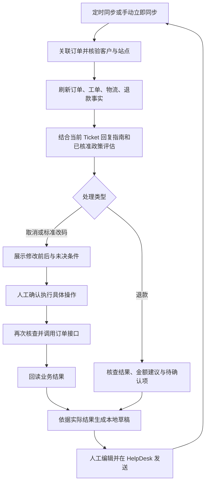

# Ticket 订单处理工作台：取消、标准改码与退款核查

日期：2026-10-22。状态：已完成本地工作台与受控执行框架；真实订单写入默认关闭，源系统校验和 n8n 在线验收待完成。

## 1. 一期范围与成功标准

用户确认：纳入取消和标准改码；退款先做核查与建议；发送暂留 HelpDesk。

| 场景 | 一期处理深度 | 完成条件 |
| --- | --- | --- |
| 数据同步 | 复用定时增量同步，提供一处立即同步入口；处理时查询关联业务事实 | 显示来源、查询时间和失败项，不用旧数据冒充最新数据 |
| 整单取消 | 核查、政策评估、操作预览、人工确认执行、回读、草稿 | 订单及相关商品/工单状态核验；退款和通知单独标识 |
| 标准改码 | 明确商品与目标标准尺码、评估、预览、人工确认执行、回读、草稿 | 商品、对应测量值及相关工单一致 |
| 退款 | 核对记录、计算建议金额、识别风险、生成建议或草稿 | 明确已查事实、计算依据和仍需确认的信息 |
| 邮件 | 本地草稿、人工编辑与复制，链接到 HelpDesk | 客服在 HelpDesk 完成发送，再同步实际消息 |

一期只处理整单取消和单件商品的标准改码。部分取消、定制测量修改、已开工修改、改色、改地址及退款执行保留人工处理。

## 2. 核心流程

评估完成后也可以先生成解释或澄清草稿。执行前草稿使用“请求已收到”“仍需确认”等对应措辞；只有回读证实后才生成“已取消”“已改为某尺码”的结果通知。

区分三项进度：业务动作是否完成、退款是否完成、客户是否已收到回复。取消成功不自动完成退款，也不自动解决或关闭 Ticket。

## 3. 页面与同步

保留现有 Laravel-Admin、Controller 和 Blade 页面，不引入完整 SPA 或通用流程编排器。

列表增加“同步最新 Ticket”，复用增量同步服务并异步执行，展示运行中、完成时间、导入数量和失败原因。筛选视图不缩窄同步范围：从 Open 变成 Pending、Solved 或 Archive 的记录也必须更新，避免待处理池保留失效记录。重复点击复用正在执行的同步任务，调度与按钮共用锁。

按用户确认的简化方案，详情不另设 Ticket 同步按钮。点击“核查处理建议”时自动查询关联订单、工单和退款，单独显示查询时间；查询失败保存失败记录，阻止使用旧结果执行。HelpDesk 数据由原定时任务或列表“立即同步”更新。

详情按工作顺序展示：消息时间线、订单与工单事实、当前 Ticket 回复指南、处理建议/动作预览、本地草稿。历史 Decision Case 审核保留为辅助区域，不参与当前订单事实或政策授权。

`Tickets to handle` 沿用当前代码口径：`silo=tickets + status=open + 未分配 agent`。这只能说明当前未分配，不能证明从未指派或从未处理。

优先级和处理难度分别展示：取消或改码窗口即将消失、临近活动日期、重复催促的优先；资料完整且无需外部确认的列为“可快速处理”。未分配队列需要及时首轮判断，Pending/On hold 中到期的跟进也应浮出，避免只按状态排序。

## 4. 订单关联与当前事实

先从当前对话提取订单号；无订单号时可按请求人邮箱查候选订单。多个候选必须由客服选择，并保存关联依据；不默认取最近一笔。人工输入订单号也要校验客户邮箱和站点，不因手工输入跳过身份检查。

最小事实集：

- 客户、站点、订单号及具体商品 ID。
- 付款金额、币种、付款方式、订单状态。
- 各商品状态、当前尺码和测量值、对应工单及生产进度。
- 所有相关包裹、发货时间、物流记录；不能仅凭状态中文判断交付。
- 退款记录及其状态、已退与待退金额、可见的争议信息。

列表接口读取完整分页；无法确认是否取全时标记事实不完整。字段缺失表示未知，不能按“尚未生产”“没有退款”“没有争议”处理。内部系统退款记录也不能单独证明支付渠道已结算或客户已到账。

快照记录来源、时间、相关业务字段指纹、请求 ID；仅把回复必需且可分享的事实交给 AI。执行时重新读取，不沿用草稿的十分钟事实窗口作为写入许可。

同一订单的多个 Ticket 显示关联提示，复用订单操作结果；一期不自动合并远端 Ticket。执行锁与去重范围覆盖站点和订单，而不能仅覆盖当前 Ticket。

## 5. 当前 Ticket 回复指南

提供一个可选的自然语言输入框，例如：“工厂已确认可在开工前改为 20W；客户尚未确认 20 是否指 20W。”

独立保存内容、编辑人和时间。只用于当前 Ticket，不随 HelpDesk 同步覆盖，也不自动升级为商品能力或全局政策。补充信息可以支持解释与澄清，但不能覆盖实时 API 状态或已核准政策。

指南参与输入快照和 hash，进入规划、草稿和独立审核环节。消息、订单关联、指南、政策版本或关键业务事实改变后，旧评估与草稿标记待更新；执行前必须重新评估。

人工指南不是执行权限。写了“可以退款”只影响退款建议，不创建退款；写了“可以修改”也不能绕过生产状态限制。

## 6. 整单取消

核查客户明确取消意愿及涉及范围，逐项检查付款、生产、发货、既有取消与退款记录，并引用适用站点的已核准取消政策版本。API 返回可修改只是技术条件，不能代替政策资格。

结果分为“可进入取消确认”“需工厂/政策人工核实”“已取消，核查后续退款”。条件不完整时直接展示缺项和下一步，不要求客服填满无关字段。

预览显示整单及全部关联商品/工单、当前状态、拟取消状态、政策依据、客户请求证据、已退金额和退款待办。客服确认的是这一笔订单的整单取消，不附带退款或邮件发送。

需要工厂暂停制作的，提供跟进建议或人工登记结果；没有接口回读或明确工厂确认，不能显示“已暂停”。取消请求紧急时先浮出这项待办，不等待邮件润色。

执行后回读订单、全部关联商品和工单；状态不一致进入待核查。已被其他客服取消的显示“已取消，无需重复执行”，继续核对退款，不能把本次点击记为一次成功写入。

## 7. 标准改码

首期条件：客户明确目标尺码、目标商品明确、订单及商品可修改、相关工单尚未开工、商品尺码表中存在目标标准尺码。`18`、`18W`、`20`、`20W`分别处理，不能自动补 W 或把 W 当成可忽略后缀。

预览展示商品名称与 ID、原尺码、目标尺码、目标测量值及单位、受影响工单。其他商品不随此动作修改。

执行后必须核验三层：订单商品尺码正确、对应测量值正确、所有相关工单正确。接口成功但任一层不一致时，只能显示部分结果待核查，不能生成无条件的修改完成通知。

客户未明确 20/20W、目标尺码表缺失、工单开工或涉及定制尺寸时，给出澄清草稿或人工处理建议。

## 8. 退款核查与建议

展示实付、币种、原支付方式、已退与待退记录、适用商品金额、运费/保护费等组成；建议金额必须列出依据和计算过程，不能拿历史邮件模板中的比例或金额直接套用。

已取消但没有退款记录时显示“退款待处理”；内部记录显示已退款时说明记录来源，支付渠道状态未知则单独列出。API 未提供的拒付或临时银行入账信息保留为待核查，不推断不存在。

Afterpay 等分期付款要区分商家退款与支付机构的分期调整。无支付机构证据时不承诺剩余分期已取消，不套用统一到账时效。

本阶段不提供创建退款的按钮、执行器或 n8n 可调用能力。可以生成退款建议、待办和经客服确认后的回复草稿；未登记安排或执行证据时，不使用“已安排退款”“已退款”。

## 9. 复用现有实现与接口核查结论

本节依据 2026-10-22 本地源码核查，生产权限与行为仍须单独验收。

| 现有组件 | 计划中的增量 |
| --- | --- |
| `HelpDeskClient` / `HelpDeskImportService` / 增量同步命令 | 后台任务直接复用现有增量同步命令及导入/游标逻辑，命令内增加共用执行锁，不新增单 Ticket 同步入口 |
| `Conversation` / `ConversationDraft` | 当前指南及编辑元数据；草稿关联事实指纹和过期提示 |
| `BusinessContextSnapshot` / `CancellationCaseVerifier` | 复用核验结果展示，补齐动作所需的工单、物流、退款事实；已有取消核验不能直接充当取消资格判断 |
| `CustomerCase` / `WorkItem` | 继续承载当前处理任务，不另建一套 Case |
| `ActionProposal` | 承载取消与改码的预览、人工确认、执行和核验结果；补充必要的并发控制与状态 |
| `TicketDraftInput` / Fact Resolver / Plan Guard / n8n | 端到端增加指南、相关意图、事实及审核；不能只放开意图白名单 |
| `KnowledgeArticle` / `KnowledgeResolver` | 继续作为统一的版本化已核准政策来源，不复制一份 Ticket 专属政策 |

Console API 已有订单和商品修改的预览/确认接口：取消拟使用 `PATCH orders/{order_no}` 的 `order_status=-1`；改码拟使用 `PATCH orders/{order_no}/items/{item_id}` 的 `size`。执行需要预览 token、原因和幂等键，并显式使用 `send_email=0`。这不等于当前集成已经具备写能力；现有 `ConsoleNewClient` 只有读取方法。

已发现的发布前约束：

1. 取消的服务端校验目前主要是订单状态修改校验，并未完整校验本方案的取消政策和全部生产/发货条件。预览 token 的新鲜度检查也主要针对修改字段，不能证明工单仍待生产。跨系统取消必须验证服务端在最终提交时的原子性条件检查；仅在本地提交前 GET 一次仍有竞争窗口。必要的源系统补强应独立列为实施依赖。
2. 改码接口会拒绝已开工工单；但 `applySizeChartFields()` 在目标尺码表不存在时会保留原测量数据。因此应在提交前确认目标标准尺码表，并在源系统拒绝缺失目标测量数据的标准改码，回读再确认，避免“尺码名改了、测量值没改”。
3. 现有 `ActionProposalService` 按 Case 及参数生成幂等键，状态变更未构成订单级并发执行保护。不能直接拿它作为多个 Ticket 共用订单的安全执行器。
4. 现有 Ticket n8n 流程只支持生产与物流查询，并处于 shadow 范围。新意图须更新事实、政策、提示、审核、固定回放与发布门禁，保留 AI 无业务写入权限的边界。

## 10. 执行与失败恢复

人工确认记录操作者、目标订单/商品、具体变化、原因、预览证据与版本。写入由服务端白名单执行器完成，n8n 只生成建议和草稿。

同一站点订单的取消和改码串行执行；用数据库原子状态认领或锁避免双击和多个工作进程重复提交。一个确认动作固定一个远端幂等键及完全一致的请求体；事实或目标变化后旧确认失效。

| 结果 | 界面与恢复行为 |
| --- | --- |
| 权限不足或参数拒绝 | 显示明确错误，不更改本地业务状态 |
| 预览过期、消息/事实变化 | 要求重新核查和预览，旧确认不能执行 |
| 超时、连接中断、执行器中途退出 | 标记结果待核查，先回读及查审计；避免换新幂等键盲目重试 |
| 订单、工单、远端同步结果不一致 | 显示各层实际结果，保留人工待办，阻止“全部成功”通知 |
| 结果已核验一致 | 标记完成，关联已有 Ticket 并允许生成完成通知草稿 |

沿用 `proposed -> approved -> executing -> succeeded/failed` 主链，补充 `stale`、`uncertain`、`partial` 状态及相应人工恢复入口；不能把结果未知当作明确失败。恢复为成功也必须保存核查人和新证据。

内部请求 token、原始响应及敏感客户信息不显示在普通预览或发送给 AI。页面按钮和后端路由都检查动作权限；只读用户即使构造 POST 也不能执行。

## 11. 实施顺序与验收

| 步骤 | 交付 | 验证 |
| --- | --- | --- |
| 1 | 单一同步按钮、关联订单事实、当前指南 | 状态/目录迁移、分页、同步失败和重复点击；订单核查只涉及当前关联订单；指南变更使输入失效 |
| 2 | 取消/改码/退款评估与本地草稿 | 缺失/多订单、身份或站点不匹配、政策缺失阻止错误建议；新意图的端到端固定回放及人工审核 |
| 3 | 源系统校验补强、取消和标准改码预览/确认/执行 | API 假响应集成测试、服务端状态竞争测试、受控订单联调；订单/商品/测量值/工单回读 |
| 4 | HelpDesk 跳转与复制、结果跟进及业务反馈 | 无 HelpDesk 写请求；业务完成但未回复仍显示待通知；同步后识别实际发送的消息 |

必要回归场景包括：取消前已开工或已发货、预览后工单开工、已取消去重、同订单两 Ticket 并发、远端超时但实际成功、商品更新成功但工单未更新、18W 改 20 的歧义、目标标准尺码表不存在、多商品只改指定商品、退款金额与币种校验、临时银行入账、指南与政策冲突、旧草稿中错误的完成措辞。

使用脱敏和冻结事实建立回放用例，不拿真实客户订单做写入测试。PHP 测试通过、n8n 注册/导入与回放通过、源系统部署、受控订单验收分别记录，不能用其中一项代替其他项。

日常处理后记录建议采纳/修改/拒绝、缺失事实、动作失败与核验不一致原因。个案处理经验先作为候选，再经人工审核进入统一知识库，不能因一次工厂答复直接形成全局规则。

## 12. 相关文档

- [Ticket 调查、处理判断与回复生成设计](ticket-investigation-reply-workflow.md)：针对人工决定、多来源调查、继续跟进及独立修订审核的审查和后续改造方案；尚未实现。
- [原工作台计划](../discovery/12-ticket-management-workbench-plan.md)：本文更新取消、改码与发送的后续范围，不改变已实现功能的说明。
- [同步与日常管理](../discovery/13-helpdesk-sync-and-ticket-operations.md)：继续沿用状态、目录与公共待处理池定义。
- [当前 Ticket shadow 工作流](../runbooks/ticket-n8n-shadow-workflow.md)：当前发布边界仍以实际代码、注册状态与验收结果为准。

## 13. 当前交付与启用边界

本地已实现：单一立即同步按钮、后台复用增量同步命令、定时与手动共用锁、订单/工单完整分页核查、客户与站点校验、多订单选择、当前 Ticket 指南、过期检查、退款只读建议、取消/改码预览及执行审计框架、回读核验、复制草稿与 HelpDesk 跳转。

- 手动同步使用 Laravel 13 的 `background` 连接启动原命令，不要求新建常驻队列 worker。需部署环境允许 Laravel 后台进程，且 PHP CLI 与 Web 配置一致。失败信息从账户 `sync_error` 查看；自动定时任务保留不变。
- 新增迁移 `000060`（Ticket 指南及订单关联）和 `000061`（用户已确认的核查/回复流程及发布版本）。流程文章不包含退款比例、资格和时效，不替代站点财务政策，也不能用作执行预览的资格政策。
- 动作预览必须选择明确绑定对应意图的 `verified + policy` 文章，并由客服确认客户意愿、制作状态及资格。没有此类政策时，仅提供核查/回复流程，不开放预览。
- `CONSOLE_NEW_TICKET_ACTIONS_ENABLED=false` 为默认值；即使开启，预览响应也必须明确返回 `guard_contract=ticket-order-state-v1`，否则禁止提交。当前 console-new 源码尚未提供此契约，因此不能在现有生产接口上启用写入。
- 源接口须在最终事务内锁定相关订单/商品/工单/物流记录，并校验提交的 `expected_state.order`、`expected_state.work_orders`，状态变化时拒绝请求；还须拒绝缺失目标标准尺码测量表的改码。现有普通预览 token 的字段检查不满足此契约，不允许仅添加能力标记绕过实际校验。
- 执行框架使用固定幂等键，订单级互斥与数据库原子认领；超时、未知结果、部分一致分别保留核查状态，恢复入口只读，不自动重试写入。预览 token 加密保存，不展示给客服或 AI。
- n8n JSON 已扩展三个只读意图及指南独立审核，固定回放集扩展为 60 条。已在本地 Laravel 注册为 `evaluating`，并于 2026-10-22 更新本机运行中的 Ticket 工作流；正式发布仍须完成固定回放集与人工审核。
- 未执行真实订单取消、改码、退款或 HelpDesk 发信。源系统补强、受控订单联调与生产发布仍是独立交付事项。

本地已执行 `000060` 和 `000061`，执行前已备份 SQLite 至 `storage/app/private/backups/`（0600）。仅本地迁移，不代表生产部署。

### 12067 会话衔接修正（2026-10-22）

- Ticket 站点缺失时，先核对订单邮箱，再将订单域名与启用站点精确匹配；只有唯一匹配且订单、工单完整核查成功，才保存站点与关联订单。邮箱不匹配、域名未知或多重匹配继续阻止处理。
- 回复指南与生成使用同一表单。页面提交时先保存指南，再复用有效核查或自动刷新；核查失败直接返回核查区域，不启动 n8n。进入生成后返回草稿区域，明确展示等待、运行、待审核及被阻止状态。
- 第一阶段规划接收有效核查中的脱敏事实，后续事实解析和最终审核仍检查时效及输入一致性。客户说 return 而订单未发货时，需要区分取消与收到商品后的退货，不重复索取已查明的订单号，也不将“可以取消”写成“已经取消”。
- 内部完成接口保留并校验指南的独立复核字段，避免复核证据在请求校验阶段丢失。旧版 n8n 提示词必须随接口更新，否则仍无法通过指南复核。
- 本机会话 12067 的真实 n8n 执行 `662` 已跑完：订单事实、`refund_review` 意图及指南独立复核均已传递。草稿 `219` 区分未发货取消与收货后退货，不重复索取订单号；因当前取消政策内容缺失保留 `blocked`，未自动放行资格或退款承诺。该单次验证不代表 60 条固定回放集已完成验收。
