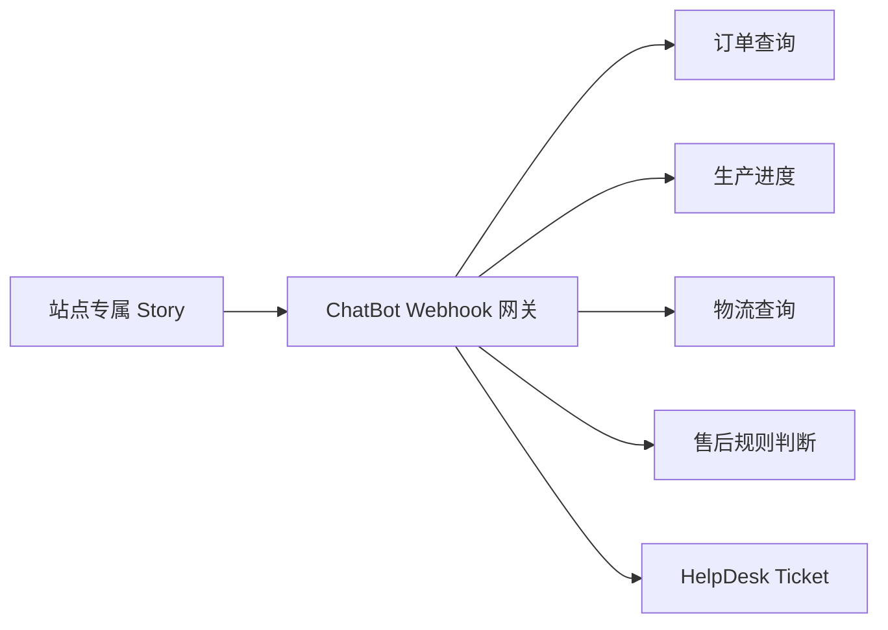

# ChatBot 能力边界与演进方案

## 文档目的

本文基于 2026-09-30 的 ChatBot.com 官方文档、真实账号 API 数据和 `Alberich Bot` Story 快照，明确多语言、业务 API、多站点和 AI 能力的可行边界，并给出适合当前客服体系的落地顺序。

本文用于指导后续设计和验收，不代表已经修改线上 Bot 配置。

## 当前基线

当前实际运行的是 `Alberich Bot`：

- 已发布，连接 HelpDesk、OpenWidget 和 Widget。
- Story 语言为英文，使用 Production 模型。
- 流程以固定 Story 分支、静态回答和创建 HelpDesk Ticket 为主。
- Story 中没有 Webhook 节点，尚未实时查询订单、生产、物流或退款系统。
- `knowledgeExtended=false`、`knowledgeUrl=false`，当前 API 快照没有显示已启用扩展知识或 URL 知识。
- Training 中已有法语、波兰语、西班牙语及商品编号相关的未匹配输入。

详细流程分析见 [Alberich Bot Story 初步分析](09-alberich-story-analysis.md)。

## 决策摘要

| 主题 | 平台能力 | 当前状态 | 建议决策 |
| --- | --- | --- | --- |
| 多语言 | 支持大多数常用语言；AI Bot 可按用户语言回答 | `Alberich Bot` 主要为英文 | 网站语言属性优先，AI 语言识别补充 |
| 业务 API | Webhook 可调用外部系统并返回消息和属性 | 当前没有 Webhook 节点 | 建立统一只读 Webhook 网关 |
| 多站点 | 可创建多个 Bot、Story 和 Widget | 尚未形成站点隔离方案 | 每站点一个独立 Bot/Story |
| AI 回答 | 支持 AI Assist、AI Knowledge 和 Training | 知识能力可能未启用 | 先治理知识和流程，再逐步启用 |
| 高风险操作 | 技术上可由 Webhook 连接业务系统 | 当前通过 Ticket 交由人工 | 取消、退款、改单继续人工审批 |

## 1. 多语言能力

### 平台能力

ChatBot.com 支持大多数常用语言，但不同 Bot 类型的行为不同：

- 通过网站或帮助中心知识源自动创建的 AI Bot，可以根据用户开始聊天时使用的语言调整回答语言。
- 从零搭建的 Visual Builder Story 只理解创建和训练时使用的语言。
- 固定 Bot Response 不会自动翻译，需要为各语言配置回复并通过 Filter 选择。
- Chat Widget API 可以通过 `setSessionAttributes` 将网站当前语言传入 Story。
- LiveChat 集成可以根据 Group 属性切换语言。
- 部分 System Entities 和模板仅提供英文版本。

### 推荐实现

语言判定按以下优先级执行：

1. 使用网站当前语言作为首选语言。
2. 没有网站语言时，使用用户主动选择的语言。
3. 用户输入语言明显不同于当前语言时，由 AI 或后端识别并更新会话语言。
4. 语言不受支持或置信度低时，使用简短英文提示并允许转人工。

需要把 `language` 保存到 Chat、Webhook 请求和 HelpDesk Ticket 中，避免客户转人工后再次说明语言。

### 验收标准

- 网站英语、法语、西班牙语版本能进入正确语言的欢迎和固定流程。
- 同一个售前问题使用不同语言提问时，回答语言与客户输入一致。
- 固定政策回复不会引用其他站点或其他语言版本的政策。
- 低置信度语言识别能进入可控兜底，不直接创建无内容 Ticket。

## 2. 业务 API 与售后能力

### 平台能力

Webhook Action 可以向外部服务发送聊天、用户和会话属性，外部服务可以返回：

- 显示给客户的 Bot Response。
- 写入会话的 Attributes。
- 供后续 Filter 使用的结构化结果。

官方 Shopify 集成已经提供使用订单号和邮编查询订单状态的流程，订单类实时查询属于平台支持的使用方式。

### 推荐架构

由本项目提供统一 Webhook 网关，不让 ChatBot 直接适配每个内部系统。网关负责：

- 根据可信的 Bot 或连接标识识别站点。
- 校验订单号、邮箱或邮编等必要身份信息。
- 调用对应站点的订单、生产、物流和退款服务。
- 将内部状态转换为稳定、可展示的客服状态。
- 记录 Chat ID、Story、站点、请求类型、结果和 Ticket 关联。
- 隐藏内部错误及不应展示的客户资料。

### 操作边界

| 操作 | 第一阶段处理方式 |
| --- | --- |
| 订单是否存在 | 自动只读查询 |
| 生产进度 | 自动只读查询 |
| 物流单号和最新状态 | 自动只读查询 |
| 退货或退款规则解释 | 使用已审核政策回答 |
| 是否可能满足退款条件 | 规则预判并明确为预判 |
| 修改地址、商品或尺码 | 创建 Ticket，人工确认 |
| 取消订单 | 创建 Ticket，人工确认 |
| 批准退款或补偿 | 创建 Ticket，人工审批 |

### 验收标准

- 正确订单信息能返回与业务系统一致的实时状态。
- 身份信息不匹配时不泄露订单详情。
- API 超时或失败时进入明确的兜底流程，并保留创建 Ticket 的入口。
- Ticket 包含 Chat ID、站点、订单号、问题类型和已收集信息。
- Webhook 不执行未经人工批准的订单或资金写操作。

## 3. 多站点方案

### 推荐决策

每个站点配置独立 Bot/Story，共享统一的 Webhook 后端和分析模型。

独立内容包括：

- Widget 和品牌展示。
- 政策、FAQ 和 AI Knowledge。
- Training 短语。
- Story 发布和版本记录。
- 站点对应的 API 路由配置。

统一内容包括：

- 意图分类和节点命名规范。
- Webhook 请求与响应协议。
- Ticket 字段和 Chat 关联方式。
- Chat 质量、兜底率和转人工率指标。
- 通用流程模板和测试用例。

### 不推荐共用一个 Story 的原因

- 不同站点政策容易相互污染。
- API、订单格式和身份验证规则可能不同。
- 一个大型 Story 的语言和站点 Filter 会快速增加维护成本。
- AI Knowledge 和 Training 在 Bot 之间本来就是隔离的。
- 出现错误时难以只回滚一个站点。

### 复制 Story 的限制

ChatBot.com 可以复制 Bot 结构，但官方说明：

- 不复制 AI Knowledge。
- 不复制 Training。
- 不复制应用集成。
- Go To 节点需要重新选择。

因此复制只用于建立新站点初始结构。发布前必须逐项检查知识、训练、集成、Webhook 和全部 Go To。

## 4. AI 演进方向

### 平台原生能力

AI Assist 可以使用网站、文章、KnowledgeBase、Zendesk 和 Training 生成动态回答。ChatBot 会先匹配 Story 结构，结构没有答案时再查询 AI 模块。

适合交给 AI 的问题包括：

- 商品材质、尺码、颜色和定制方式等开放式售前问题。
- 配送、退货和退款政策解释。
- 用户使用不同表达方式提出的常见问题。
- 多语言问答和后续追问。

每个 Bot 的 AI Knowledge 和 Training 独立，需要为每个站点单独配置和验证。

### 自建智能层

Webhook 网关后续可以接入模型，完成：

1. 语言和意图识别。
2. 站点专属政策检索。
3. 判断是否需要业务 API 数据。
4. 调用订单、生产、物流或退款查询。
5. 根据真实结果组织自然语言回答。
6. 判断直接回复、继续追问或创建 Ticket。
7. 从历史 Chat 和 Ticket 中发现 Story 与知识缺口。

生成式模型不能自行推断订单事实、退款结果或补偿方案。所有业务状态来自 API，所有政策来自已审核知识，所有写操作继续使用确定性规则和人工审批。

### 新产品方向

ChatBot.com 当前建议新配置使用 Text AI Agent。它使用 Knowledge、Instructions、Customer Context 和 Skills 回答问题并执行动作；现有 Visual Builder 与 AI Assist 仍然可用。

在现有 `Alberich Bot` 完成数据闭环、知识治理和 Webhook 验证之前，不直接替换线上 Bot。后续可以选择一个低风险站点或测试 Widget，对 Text AI Agent 做独立验证并比较：

- 问题解决率。
- 回答事实准确率。
- 兜底率和转人工率。
- Ticket 内容完整度。
- 单次有效会话成本。

## 5. 分阶段落地计划

### 阶段一：建立可观测基线

工作内容：

- 持续同步 Chat、Story、Training 和 HelpDesk Ticket。
- 建立 Chat 与 Ticket 的稳定关联。
- 标注有效 Chat、测试流量、无价值 Chat 和高风险案例。
- 统计未匹配率、兜底率、Ticket 转化率和中途退出率。

完成标准：可以按站点和 Story 解释客户主要问题、Bot 失败位置及创建 Ticket 的原因。

截至 2026-10-02，历史同步框架和定期同步已经落地。当前数据库包含 API 可访问的 400 条 Chat 和 4,819 个 Event；继续向前分页时 API 在当前历史边界返回 403，详情见 [ChatBot API 能力与接入边界](08-chatbot-api-discovery.md#历史会话同步运行状态)。Chat 与 HelpDesk Ticket 的稳定关联、价值分类和指标统计仍属于本阶段后续工作。

### 阶段二：整理 Story 与知识

工作内容：

- 修复当前 5 个未配置订单节点。
- 合并 11 套重复 Ticket 创建流程。
- 取消默认兜底直接创建 Ticket，先增加澄清和问题分类。
- 为每个站点整理经过审核的政策与 FAQ。
- 补充高价值 Training，过滤单字符、机器人和无上下文噪音。

完成标准：核心售前和政策问题可稳定回答，低价值 Ticket 明显减少。

### 阶段三：接入只读售后 API

优先顺序：

1. 订单存在性与基础状态。
2. 生产进度和预计发货时间。
3. 物流单号和运输状态。
4. 退货、取消和退款资格预判。

完成标准：使用受控测试订单完成身份校验、正常状态、无订单、API 超时和转人工的端到端测试。

### 阶段四：启用和评估 AI

工作内容：

- 在单个站点启用经过审核的 AI Knowledge。
- 建立回答抽样审核和事实错误记录。
- 比较启用前后的解决率、兜底率、转人工率和客户追问情况。
- 从 Chat 和 Ticket 中生成知识及 Story 优化候选，由人工审核后发布。

完成标准：AI 回答的事实准确率达到约定门槛，并且没有增加错误政策回答或错误售后承诺。

## 6. 数据闭环

每次会话至少应记录：

- 站点、Story、版本和语言。
- 用户原始问题及识别意图。
- 命中的 Story 节点、Training 或知识来源。
- 是否调用业务 API 及结果类型。
- 是否进入兜底、创建 Ticket 或转人工。
- Ticket 最终处理结果。
- 是否属于可清理的低价值 Chat。

这些数据用于回答三个问题：

1. Bot 没有理解什么？
2. Bot 理解了但缺少什么知识或业务数据？
3. 哪些问题应该继续自动化，哪些问题必须由人工处理？

## 7. 官方资料

- [Supported languages](https://www.chatbot.com/help/overview/supported-languages/)
- [How to make your chatbot multilingual](https://www.chatbot.com/help/build-your-chatbot/how-to-create-multilingual-chatbot/)
- [How to set up webhooks](https://www.chatbot.com/help/webhooks/setting-up-your-webhook/)
- [Show Shopify order status](https://www.chatbot.com/help/shopify-integration/show-shopify-order-status/)
- [What is ChatBot.com AI Assist](https://www.chatbot.com/help/artificial-intelligence/what-is-chatbot-ai-assist/)
- [What is AI Knowledge](https://www.chatbot.com/help/artificial-intelligence/what-is-ai-knowledge/)
- [Duplicate your chatbot](https://www.chatbot.com/help/stories/clone-your-story/)
- [Install ChatBot.com using Chat Widget](https://www.chatbot.com/help/install-chatbot/widget-installation/)
