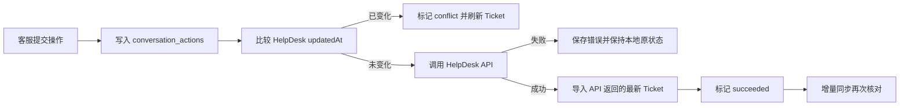

# Ticket 管理工作台实施计划

> 2026-10-22 范围更新：[Ticket 订单处理工作台设计](../architecture/ticket-order-actions-workflow.md)将整单取消和标准改码纳入下一阶段，退款仅核查与建议，邮件发送保留在 HelpDesk。下文关于业务写入暂缓和 HelpDesk 发送的早期规划，以该设计的一期范围为准；这项范围更新不代表功能已实现。

## 1. 目标

在现有 Laravel-Admin 中建立一个日常可用的 Ticket 工作台，将 HelpDesk Ticket、规则分析、Decision Case、人工审核和回复草稿放在同一页面。

第一阶段的成功标准：

- 客服可以通过状态、目录、站点、问题类型、风险和待审核状态快速找到 Ticket。
- Ticket 详情按时间完整展示客户消息、客服回复、私密备注和状态变更。
- 审核人员可以查看 AI 案例、决策节点及其原始证据，并确认、修正或拒绝结果。
- 客服可以先保存本地回复草稿；在远端写入能力启用后，再从同一界面发送回复或私密备注。
- 所有对 HelpDesk 的写操作都可追踪、可判定成功或失败，不会只修改本地状态造成假成功。

## 2. 产品边界

这个工作台不需要完整复制 HelpDesk。它重点解决当前 HelpDesk 页面没有覆盖好的三件事：

1. 跨站点、分类、风险、案例审核状态的统一检索。
2. Ticket 原始对话与 AI 分析证据的并排审核。
3. 从人工草稿、AI 建议到受控发送的处理闭环。

HelpDesk 继续作为 Ticket 和客服操作的远端事实来源；本项目保存同步副本、分析结果、审核意见、草稿和操作审计。

## 3. 页面结构

### 3.1 Ticket 队列

采用接近 HelpDesk 的两栏结构：左侧导航和右侧列表。

左侧导航首批提供：

- 全部近期 Ticket。
- 待处理：`open + pending + onhold`。
- Open、Pending、On hold、Solved、Closed。
- Archive、Spam、Trash。
- 需要人工审核。
- 已生成 Decision Case、尚未生成 Decision Case。
- 高风险案例。
- DressAfford、EllenBridals、站点未知。

每个入口显示本地数据库实时计数。筛选条件写入 URL，便于刷新、返回和分享同一视图。

Ticket 列表首批字段：

- 请求人名称和邮箱。
- Ticket ID、主题。
- 站点。
- HelpDesk 状态、目录、优先级。
- 当前 Team/Agent。
- 规则问题类型、紧急度。
- Decision Case 状态、风险和节点数。
- 最后消息时间。

列表支持关键词搜索、组合筛选、分页和按最后消息时间排序。首批使用服务端分页，每页 50 条，不一次加载全部消息。

### 3.2 Ticket 处理页

采用主内容区加右侧详情栏。

主内容区：

- 顶部显示 Ticket ID、主题、站点和同步时间。
- 时间线展示公开消息、私密备注、状态变化、分配变化和附件。
- 客户、客服、系统事件使用不同视觉样式。
- HTML 正文经过白名单净化，避免邮件内容形成 XSS。
- 每条 AI 证据可以定位并高亮对应原始事件。

右侧详情栏分为：

1. **Ticket 信息**：状态、优先级、来源、语言、创建时间、最后消息时间。
2. **责任信息**：Team、Agent、关注人。
3. **分类与风险**：站点、规则类别、问题类型、紧急度、多问题标记。
4. **Decision Case**：案例摘要、风险、审核状态和决策节点。
5. **标签与自定义字段**：HelpDesk 标签、订单号等业务字段。
6. **同步状态**：本地同步时间、HelpDesk 更新时间、最近写操作状态。

### 3.3 回复与审核区

回复区首批包含：

- 公开回复 / 私密备注切换。
- 回复正文。
- 发送后状态。
- 保存本地草稿。
- AI 回复候选及其依据。
- 提交按钮。

初始实施时，提交按钮只保存草稿。完成远端写入和真实测试 Ticket 验收后，再开启发送功能。

Decision Case 审核支持：

- 确认案例。
- 修正案例分类、风险、摘要和节点字段。
- 拒绝错误案例并记录原因。
- 逐节点查看 request、fact、decision、reason、action、outcome 等证据。
- 记录审核人和审核时间。

## 4. 数据职责

### 4.1 HelpDesk 远端事实

以下字段由 HelpDesk 控制，同步时可以覆盖本地副本：

- Ticket 状态、优先级、目录。
- 请求人、Team、Agent、标签、自定义字段。
- 消息、私密备注、附件和状态事件。
- HelpDesk 创建时间、更新时间和最后消息时间。

### 4.2 本地智能与审核数据

以下数据只由本项目维护，不受 HelpDesk 同步覆盖：

- 规则分类和多标签。
- Decision Case、决策节点和证据。
- 人工审核状态、修正内容和审核意见。
- AI 回复候选和人工编辑稿。
- 本地保存视图及操作审计。

### 4.3 建议新增的数据表

#### `conversation_drafts`

保存尚未发送的草稿：

- `conversation_id`
- `body`
- `is_private`
- `status_after_send`
- `source`：manual、ai、template
- `created_by`、`updated_by`
- `sent_at`

#### `conversation_actions`

记录每次远端写操作：

- `conversation_id`
- `action_type`：reply、private_note、status、priority、assignment、tags、silo
- `payload`
- `idempotency_key`
- `expected_remote_updated_at`
- `status`：pending、running、succeeded、failed、conflict
- `attempt_count`
- `requested_by`
- `remote_response`
- `error_message`
- `started_at`、`finished_at`

#### HelpDesk 配置缓存

同步并缓存 Agent、Team、Tag 和 Custom Field，供筛选和表单选择使用。可以按资源拆表，保持外部 ID 和最后同步时间，不把这些配置塞进 Ticket 快照中作为唯一来源。

## 5. HelpDesk API 写入能力

官方 API v1 已确认支持：

- `PATCH /v1/tickets/{ticketID}`：发送公开消息或私密备注，并更新状态、主题、优先级、分配、标签、自定义字段等。
- `POST /v1/tickets/{ticketID}/tags`：添加标签。
- `DELETE /v1/tickets/{ticketID}/tags/{tagID}`：删除标签。
- `PUT /v1/tickets/{ticketID}/silo`：移动到 tickets、archive、spam 或 trash。
- `POST /v1/tickets`：创建 Ticket。

当前 Personal Access Token 只经过读取验证。启用写操作前必须用受控测试 Ticket 核对账号角色、授权范围和每个请求结构，不能根据接口存在就直接对真实客户 Ticket 开放。

## 6. 写操作一致性

远端写入按以下流程执行：

关键约束：

- 前端不能先把本地 Ticket 改成成功状态。
- 回复和私密备注提交时生成本地幂等键，防止双击重复发送。
- 用 `expected_remote_updated_at` 做乐观并发检查；远端已被其他客服修改时先刷新再决定。
- API 返回成功后立即导入返回的 Ticket，小时级增量同步只承担最终核对。
- 失败操作保留错误和请求摘要，但不记录凭据。
- Archive、Spam、Trash 和删除附件等高影响动作首批不提供批量操作。

## 7. 权限

使用 Laravel-Admin 现有用户、角色和权限：

| 角色 | 权限 |
| --- | --- |
| Viewer | 查看 Ticket、分析和证据 |
| Reviewer | Viewer 权限，加上审核和修正本地 AI 结果 |
| Agent | Reviewer 权限，加上回复、私密备注、状态、优先级和分配操作 |
| Admin | Agent 权限，加上远端写入开关、配置同步和角色管理 |

AI 自动生成的回复必须经过 Agent 提交。后续自动发送需要单独的策略、置信度和风险控制，不能复用普通 Agent 权限直接放开。

## 8. 技术实现

保留 Laravel-Admin 作为登录、菜单和权限外壳。Ticket 工作台使用自定义 Controller 和 Blade 页面实现，不继续把复杂交互塞进默认 Grid/Show，也暂不引入完整 SPA 框架。

建议组件：

- `TicketWorkbenchController`：页面入口。
- `TicketQueryService`：计数、搜索、筛选、分页。
- `TicketDetailService`：时间线、分析、案例和证据组合。
- `HelpDeskTicketActionService`：受控写入与响应导入。
- `DecisionCaseReviewService`：人工审核和修正。
- 少量页面 JavaScript：列表切换、筛选、详情刷新、草稿和提交。

数据库增加组合索引：

- `(silo, status, updated_at_external)`
- `(site_key, status, updated_at_external)`
- Decision Case 的 `(review_status, case_risk, extracted_at)`

当前约一万张 Ticket，SQLite 足以支持首批工作台。搜索先覆盖 Ticket ID、主题和请求人邮箱；需要正文全文检索时再单独评估 SQLite FTS 或 MySQL，不在基础版本中提前引入。

## 9. 分阶段实施

### 阶段一：只读工作台和本地审核

- 自定义 Ticket 队列、侧边计数和组合筛选。
- 自定义 Ticket 处理页和完整时间线。
- 展示规则分析、Decision Case、节点及证据。
- 完成案例确认、修正、拒绝。
- 支持本地回复草稿，不调用 HelpDesk 写接口。

验收：计数与 SQL 一致；筛选稳定；事件顺序正确；私密消息明确标识；HTML 安全；案例审核有审核人和时间。

### 阶段二：HelpDesk 受控写操作

- 同步 Agent、Team、Tag 和 Custom Field。
- 实现状态、优先级、分配和标签修改。
- 实现公开回复和私密备注。
- 实现操作审计、幂等、防并发覆盖和失败恢复。
- 使用专用测试 Ticket 做真实 API 验收后开启生产入口。

验收：成功操作在 HelpDesk 和本地一致；失败时本地不显示假状态；重复点击不重复发送；远端并发修改触发冲突提示。

### 阶段三：AI 辅助处理

- 根据 Ticket、已批准策略和订单事实生成回复建议。
- 展示引用策略、缺失事实、风险和置信度。
- 记录人工采纳、修改和拒绝，用于持续改进。
- 只对已批准、低风险、高置信度场景评估自动发送。

## 10. 暂缓功能

基础版本暂不实现：

- 批量删除、批量移动 Spam/Trash。
- 完整复制 HelpDesk 的宏、自动化规则和报表管理。
- 新建 Ticket、合并 Ticket 和附件删除。
- 对退款、取消、改地址等业务系统执行写操作。
- 未审核策略驱动的自动回复。

这些能力可以在工作台稳定、权限和操作审计经过真实使用后逐项加入。

## 11. 参考

- [HelpDesk.com API v1](https://api.helpdesk.com/docs)
