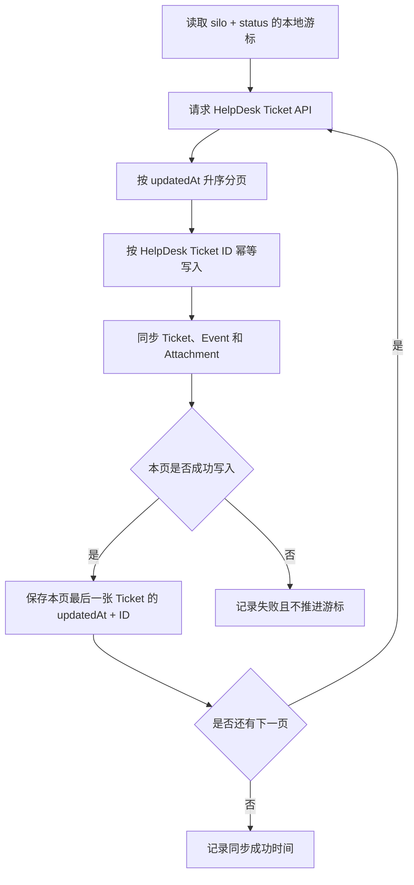

# HelpDesk 同步与 Ticket 日常管理流程

## 1. 文档目的

本文记录当前 HelpDesk 数据同步机制、Ticket 各维度的关系、日常管理顺序以及一致性保障边界，作为后续运维、客服交接和后台功能演进的依据。

当前原则：

- HelpDesk 是 Ticket、消息、状态、目录和分配关系的远端事实来源。
- 本项目保存可重复同步的本地副本，以及本地分类、Decision Case、人工审核和回复草稿。
- 同步操作按外部 ID 幂等写入，可以安全重复执行。
- 数量一致是基础检查，业务字段和事件完整性仍需通过抽样及异常审计确认。

## 2. 同步数据范围

HelpDesk Ticket 按两个远端维度拆分同步。

### 2.1 Silo：Ticket 所在目录

| Silo | 含义 | 主要用途 |
| --- | --- | --- |
| `tickets` | 当前正常工作区 | 客服日常处理 |
| `archive` | 已归档 Ticket | 历史查询、案例学习和策略归纳 |
| `spam` | 垃圾信息 | 定期检查误判 |
| `trash` | 回收站 | 核查误删除 |

### 2.2 Status：Ticket 处理进度

| Status | 管理含义 | 日常动作 |
| --- | --- | --- |
| `open` | 当前需要客服处理 | 阅读、判断、分配和回复 |
| `pending` | 通常已回复，正在等待客户信息或确认 | 检查客户是否回复，处理超时等待 |
| `onhold` | 等待内部、供应商、物流等外部条件 | 记录阻塞原因、责任人和跟进时间 |
| `solved` | 当前问题已经解决 | 观察是否复发，必要时归档 |
| `closed` | 流程最终结束 | 保留查询，通常不再处理 |

Silo 和 Status 是两个独立维度。Archive 不是一种处理状态，归档 Ticket 仍可能保留原来的 `open`、`pending` 或 `solved` 状态。

同步程序为四个 Silo 和五种 Status 的每个组合分别维护游标，共 20 个组合。

## 3. 增量同步机制

### 3.1 复合游标

每个 `silo + status` 组合保存独立的复合游标：

```text
updatedAt = 最后一张已同步 Ticket 的远端更新时间
ID        = 该 Ticket 的 HelpDesk ID
```

HelpDesk 请求按照 `updatedAt` 升序读取。Ticket ID 用于区分更新时间相同的多张 Ticket，避免分页时重复或遗漏。

### 3.2 单次同步流程



同步写入规则：

- Ticket 使用 `channel_account_id + external_id` 唯一定位。
- Event 使用 `conversation_id + external_id` 唯一定位。
- Attachment 使用 `conversation_event_id + external_key` 唯一定位。
- 已存在的记录更新远端字段，不存在的记录创建。
- 只有当前页成功导入后才推进游标。
- 请求或写入失败时保留原游标，下一次从原位置重试。

### 3.3 状态和目录迁移

Ticket 从 `open` 变为 `pending`，或者从 `tickets` 移入 `archive` 时，HelpDesk 会更新该 Ticket 的 `updatedAt`。

同步程序随后会在新的 `silo + status` 组合中取得同一 HelpDesk Ticket ID，并更新本地已有记录的 `silo` 和 `status`，不会创建重复 Ticket。

这个机制依赖 HelpDesk 在消息、状态、分配、目录或 Ticket 字段变化时可靠更新 `updatedAt`。

## 4. 自动执行频率

当前 Laravel Scheduler 配置：

| 时间 | 命令 | 范围 |
| --- | --- | --- |
| 每 10 分钟 | `helpdesk:sync-incremental --silo=tickets` | 正常工作区的五种状态 |
| 每小时第 5 分钟 | `helpdesk:sync-incremental` | 四个目录、五种状态 |
| 每天 02:30 | `helpdesk:analyze` | 本地问题分类和回复候选分析 |

当前 Mac 使用仓库内的 LaunchAgent 持续执行 `php artisan schedule:work`。如果迁移到服务器，应由服务器进程管理器或 Cron 持续触发 Laravel Scheduler。

## 5. 一致性保障

### 5.1 增量同步

增量同步负责持续取得所有 `updatedAt` 晚于当前游标的 Ticket，并通过幂等写入更新本地副本。

### 5.2 数量审计

执行：

```bash
php artisan helpdesk:audit
```

审计程序逐一获取 20 个 `silo + status` 组合的 HelpDesk 线上总数，并与本地记录数比较。只有 20 组全部相等时，结果才是：

```json
{
  "all_match": true
}
```

### 5.3 不一致处理

建议采用以下恢复流程：

```text
增量同步
  → 定期数量审计
  → 定位不一致的 silo + status
  → 对该组合做定向重新扫描
  → 再次审计
```

不应把全量恢复作为每次差异的默认处理。先确定发生差异的组合，再进行小范围恢复，可以降低 API 请求量和错误影响范围。

### 5.4 当前边界

当前数量审计命令已经可用，但尚未加入自动计划任务。后续应增加每天一次自动审计，并在发现差异时记录：

- 不一致的 `silo + status`。
- 线上数量和本地数量。
- 最近一次同步时间和游标。
- 同步错误信息。

如果 HelpDesk 永久删除 Ticket 且不产生可读取的更新记录，增量同步不会自动删除本地副本。数量审计可以发现差异，但仍需要定向核对和恢复。

## 6. 后台筛选的逻辑关系

后台同时存在远端事实维度和本地分析维度。

| 维度 | 示例 | 数据来源 |
| --- | --- | --- |
| 目录 | tickets、archive、spam、trash | HelpDesk |
| 状态 | open、pending、onhold、solved、closed | HelpDesk |
| 分配 | 未分配、Alex | HelpDesk |
| 站点 | dressafford、ellenbridals | HelpDesk Team 和 Ticket 内容识别 |
| 问题类型 | 取消、退货、物流、尺寸 | 本地规则或 AI 分析 |
| 案例审核 | candidate、confirmed、corrected、rejected | 本地人工审核 |

### 6.1 HelpDesk 风格视图

#### All recent tickets

```text
silo = tickets
包含所有状态
```

#### Tickets to handle

```text
silo = tickets
status = open
assignment.agent.ID 为空
```

这是公共待处理池，也是日常管理的首要入口。

#### My open tickets

```text
silo = tickets
status = open
assignment.agent.ID = HELPDESK_CURRENT_AGENT_ID
```

当前配置的客服是 Alex。单客服情况下，通常有：

```text
Open = Tickets to handle + My open tickets
```

如果以后增加多个客服，Open 还会包含分配给其他客服的 Ticket，需要增加客服维度的筛选和计数。

### 6.2 本地分析视图

- `Needs review`：规则分析标记需要审核，或者 Decision Case 仍是 `candidate`。
- `Has case`：已经生成 Decision Case。
- `High risk`：Decision Case 风险为 `high` 或 `critical`。

这些视图用于策略学习和审核，不改变 HelpDesk 的状态、目录或分配关系。

## 7. 日常管理顺序

### 7.1 第一优先：Tickets to handle

对未分配的 Open Ticket 完成首次判断：

1. 是否为真实客户问题。
2. 属于 DressAfford 还是 EllenBridals。
3. 客户的主要问题类型。
4. 是否需要立即回复。
5. 应当分配给谁。
6. 是否存在退款、拒付、婚期临近、投诉等高风险情况。

管理目标是控制首次响应时间，避免 Ticket 长时间无人负责。

### 7.2 第二优先：My open tickets

处理已经分配给当前客服的 Ticket：

1. 阅读完整上下文。
2. 核对订单、生产、物流等必要事实。
3. 使用已经确认的策略或回复候选。
4. 回复后根据实际情况转为 `pending`、`onhold` 或 `solved`。
5. 无法确定时保持 Open，标记风险并请求人工判断。

### 7.3 第三优先：Pending

Pending 的重点是控制等待时间：

- 客户是否已经回复。
- 要求客户提供的资料是否收到。
- 是否需要再次提醒。
- 是否已满足解决条件。

后续可增加 `0–2 天`、`3–7 天`、`超过 7 天`的等待时长分组。

### 7.4 第四优先：On hold

每一张 On hold Ticket 应明确记录：

- 阻塞原因。
- 当前责任人。
- 等待的内部或外部事项。
- 下一次跟进时间。
- 已向客户承诺的时间。

### 7.5 Solved 和 Closed

- Solved：观察客户是否再次回复或问题是否复发，必要时重新处理。
- Closed：作为最终完成记录保存，通常只用于查询和分析。

### 7.6 本地案例审核

完成紧急客服队列后，再处理：

1. 高风险案例。
2. AI 标记需要人工审核的案例。
3. 已生成但仍为 Candidate 的 Decision Case。
4. 对典型案例的确认、修正和拒绝。

案例审核的目标是形成可以复用的判断条件、处理策略和回复依据。

### 7.7 Archive、Spam 和 Trash

- Archive：用于历史检索、案例归纳和策略学习。
- Spam：定期抽查是否误判了真实客户消息。
- Trash：定期核查是否存在误删除，不作为日常主队列。

## 8. 管理目标

HelpDesk 队列回答：

```text
现在有哪些 Ticket，需要谁来处理，处理到了哪一步？
```

本地分类和 Decision Case 回答：

```text
客户提出了什么问题，过去如何判断和处理，以后应当采用什么策略？
```

短期运营重点是保持队列及时、责任清晰和状态准确；长期建设重点是把经过审核的真实 Ticket 转化为可复用的客服策略，并逐步支持 AI 分类、回复建议和受控自动处理。
