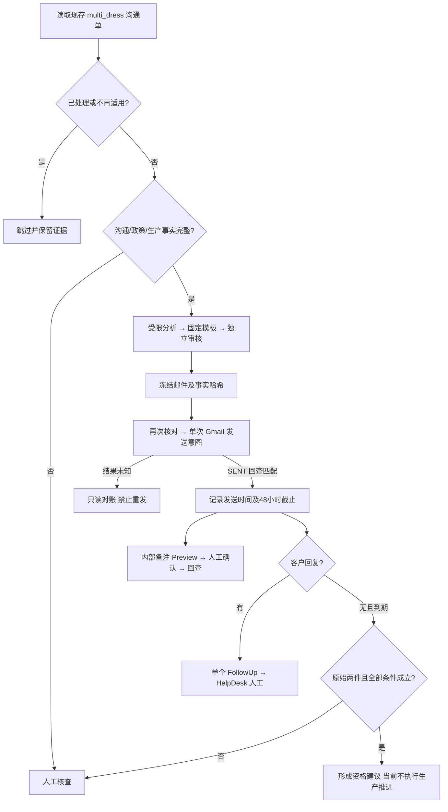

# Seawave 多件确认首轮运行手册

更新日期：2026-11-13。交付状态：源码及隔离模拟已完成，外部集成验收待完成；未迁移主实例数据库，未导入/激活 n8n，未发送真实邮件，未写入生产 Console。

## 业务范围

只处理 Seawave 的 DressAfford、EllenBridals 现有 multi_dress 沟通单。首封信采用同一主模板，加受限的问题模块，列明实际有效礼服的货号、颜色、尺寸与数量，告知订单暂停并请客户48小时内回复。不会要求所有客户一律只留一件，也不会披露内部超时后续安排。

原始两件且当前仍是同一两件，48小时无相关回复且全部条件满足，才形成超时推进建议；三件及以上继续暂停；原三件减至两件不继承资格。任意相关回复（包括“Yes”）退出无回复路径，交 HelpDesk 人工接续。ETA、comment、退款、取消、改款及后续回复发送不在本期执行范围。



## 默认配置及账号

配置为 config/customer_contacts.php；.env.example 列出所有开关，默认 shadow、scan/send/note 及两品牌发送开关关闭，政策核实为 false。timeout_execute_enabled 在源码中固定 false。此次未修改实际 .env。

Gmail 账号映射位于 config/gmail.php，保持服务器既有账号目录；发送前必须核对 CLI profile 与品牌账号一致。私有冻结邮件使用 local disk，不能放入 public storage。服务器使用现有 work 内部 Token、N8N webhook Token 和模型配置，不打印凭据。

## 安全的隔离回放

在项目根目录使用应用用户：

```bash
runuser -u csi -- php artisan contacts:multi-dress-replay --output=/tmp/multi-dress-first-round-replay.json
```

命令强制创建独立内存 SQLite，运行隔离迁移，使用独立私有文件目录及假通信/假邮件传输，最后恢复原 DB、Storage 与测试时钟。没有 live 参数，不读写原业务库。报告文件权限0600；夹具中的邮箱为 example.invalid。不要把回放输出当作生产事实或真实 AI 审核证据。

夹具来自 ebd20261105-1295 的已脱敏快照。当前状态必须跳过；历史两件状态用来模拟首信、重复执行、发送未知、备注失败、48小时边界、部分回复、三件减两件与人工交接。历史完整沟通、原始命中证明、政策核实、发送回执/回复、备注成功基线属于明确的合成条件，未补成真实历史结论。真实 Console 备注执行另由 HTTP fake 的 Preview/Confirm 测试验证。

## 安装与 shadow 验收顺序（尚未执行）

1. 按主实例发布流程备份本地 DB，审阅迁移 2026_11_13_000074；执行迁移后才有三张台账表与后台菜单。旧实例没有表时调度/页面安全返回未安装，不自行创建生产表。
2. 审阅 config/gmail.php 与 Console 终端映射。初期保留所有发送/写回开关 false。
3. 需要只读业务验收时，可运行 `contacts:multi-dress-scan --console=seawave --order=ebd20261105-1295 --mode=shadow`。该命令读取远程 Console/Gmail 和本地 HelpDesk，写本地台账，不写生产业务系统；本次未运行。已处理例单应 suppressed。
4. 补齐执行契约文档中的 HelpDesk、未生产状态等来源证明后再验收候选与首信内容，不能为跑通把 complete/policy_verified 改成无证据的 true。
5. 新工作流先以 evaluating 登记到本地注册表，再由管理员按 n8n 发布流程导入隔离环境；当前本次未登记或导入：

```bash
runuser -u csi -- php artisan n8n:register-workflow work/multi-dress-first-round-v1 1.0.0 n8n/workflows/work__multi-dress-first-round-v1.json --status=evaluating
```

6. 补真实 n8n 回放与发布门禁；当前 active 注册因缺门禁而拒绝，PHP 报告不能替代。
7. 另行批准两个品牌内部测试收件，验收显示身份、邮件外观、Gmail SENT 回查、客户回复转入 HelpDesk 与订单关联。首信、备注和超时推进分别验收后启用，不能一次全开。超时推进还需新的上游契约及实现。

## 台账、后台及调度

后台 `/admin/multi-dress-rounds` 查看事实、冻结邮件、邮件/备注/等待各自状态、操作历史及人工接管。权限分别为 customer-contacts.view/edit/execute，管理员可操作；普通角色由既有后台权限管理授予。菜单可见不代表有执行权限。

| 命令 | 作用与默认状态 |
| --- | --- |
| contacts:multi-dress-scan --draft | 每5分钟，scan 开关默认关闭；完整读取候选，符合条件才排草稿 |
| contacts:multi-dress-process-effects | 每分钟；触发已排队草稿、处理 ready 发信及未知副作用对账，开关阻止真实发信 |
| contacts:multi-dress-check-waiting | 每分钟检查 waiting/due；任何回复交人工；只形成资格，不执行 timeout |
| contacts:multi-dress-health --fail-on-unhealthy | 每5分钟；发送未知、到期与备注失败写现有日志告警 |

调度使用 withoutOverlapping；数据库唯一键与行锁才是副作用防重基础。48小时由 sent_at + 48h 持久化，不占用 n8n 等待节点或 WorkItem 租约。当前测试覆盖重复运行与交错人工接管，不代表已经做过多进程生产压测。

## 故障及人工处理

- `send_unknown`：禁止重置为 ready、删除 effect 或重新发送。原发送意图只调用 Gmail 只读 reconcile；找不到匹配仍保持 unknown，不开始48小时计时。关闭发送后 shadow/live 仍可对账。
- `sent + note pending/failed`：邮件已经发送，只处理备注。后台显示实际 Preview diff，由有权限的人员确认；失败不能触发邮件重发。明确的 CONTACT_CONFLICT/CONFIRM_TOKEN_STALE 拒绝可按最新同事内容重新预览；Note unknown 先回查，不盲目 Confirm。
- `held`：会建立一个本地 FollowUp，新的停止原因追加进展，不覆盖同事状态/负责人/日期。同一原因不重复追加。它不是向 HelpDesk 发消息；同事仍在 HelpDesk 按现行流程接续。
- 人工接管：后台记录真实用户与原因，立即使尚未领取执行的 ready 意图失效；已提交到供应商的在途操作仍须对账。当前无自动恢复按钮，禁止绕过状态机改库恢复。
- `timeout_preview_ready`：仅说明本地资格满足，execution_available=false。现有 release 不等于进生产；当前不会发送生产推进请求。
- 停止：关闭 send/品牌send/note，保留 shadow 可继续只读对账；mode=off 停止本模块扫描/执行/等待。开关不会撤销已经进入供应商的在途请求。

## 联调门禁及交付记录

完整字段要求见 [执行契约](../api/seawave-multi-dress-execution-contract.md)，代码与验证范围见 [开发交付记录](../research/2026-11-13-multi-dress-implementation.md)。上线前待补：HelpDesk 新鲜完整性及占用读取、Console 未生产证明/原始命中及原子推进、真实 n8n 回放发布门禁、两品牌受控收件和回复联调。当前代码不会因为缺数据而默认放行。
