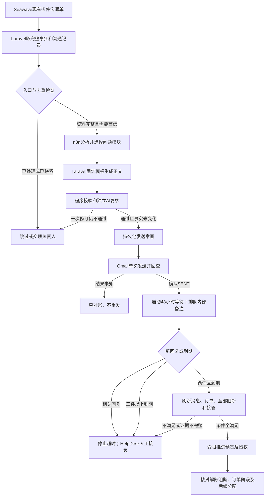

# Seawave 多件确认首轮流程开发设计

日期：2026-11-13。状态：设计及离线模拟；未启用发送、写回、放行或生产调度。

业务依据：[已确认的首轮规格](../../architecture/seawave-multi-dress-first-email.md)及[多件处理策略](../../../2026-11-12-multi-dress-processing-recommendation.md)。本文细化工程实现，不改变 Console 的拦截规则。实施任务见[开发计划](../plans/2026-11-13-seawave-multi-dress-first-round.md)，实例见[模拟报告](../../research/2026-11-13-ebd1295-first-round-replay.md)。

## 1. 目标和边界

把“读候选 → 判断是否需要首信 → 生成并审核 → 发送及对账 → 内部记录 → 等待48小时 → 回复交人工／两件超时核验／三件以上继续暂停”做成可恢复、可审计的流程。

全局约束：

- 运行环境为 Ubuntu 开发机，业务来源是远程生产系统；本地 Console 源码不是生产状态。
- 业务只处理 `console_key=seawave`，`site_key=dressafford|ellenbridals`；MyDorris 只读。
- 唯一入口是 Console 已存在的 `source=multi_dress` 沟通单；不重做拦截、不创建沟通单、不扫描全部多件订单补拦截。
- 首信告知当前暂停、要求48小时内回复；不向客户披露无回复后的内部生产规则。
- 原始两件命中且当前仍为同一两件、48小时无回复、其它条件全部满足，才可进入超时推进路径。三件及以上继续暂停；三件减成两件不继承两件资格。
- 任何相关客户回复，包括不完整答案，均停止无回复路径，交 HelpDesk 人工处理。
- ETA、comment、退款、取消、改款、后续客户邮件、HelpDesk真实发送均不在本期执行范围。
- 邮件及 Console 操作是独立副作用；写备注失败不能引发重发邮件。
- 交互式 trade 写入必须展示实际 Preview 并取得用户授权后 Confirm；AI审核、operation_id、设计批准都不能代替该授权。
- 本次模拟只使用本地文件和假传输；不创建远程草稿，不发送邮件，不更改 Console、应用数据库或定时任务。

## 2. 从项目实际结构出发

| 现有部分 | 复用内容 | 本场景新增内容 |
| --- | --- | --- |
| `CustomerCase`、`CustomerCaseSource` | 订单级来源关联、人工接管、审计入口 | `case_type=multi_dress_first_round`，无需伪造 Ticket |
| `WorkItem`、`WorkItemLeaseService` | AI任务租约、输入哈希、失败回收 | 专用 work_type、输入及输出契约 |
| n8n `work` 中心、`WorkflowRegistry` | 受限事实、生成、独立审核、一次修订 | `work/multi-dress-first-round-v1@1.0.0` |
| `ConsoleNewConnections`、`ConsoleNewClient` | 站点路由、独立终端、只读快照 | 沟通单读取封装、受限备注／超时适配器 |
| `GwsClient` | 站点账号隔离、读取、单次 `sendMimeFile` | 通用邮箱配置、完整分页、首轮发送对账 |
| `FollowUpManager` | 订单级人工待办、进度、负责人、版本 | 每首轮至多一个异常／回复待办 |
| Laravel Scheduler / queue | 小批扫描、短任务、健康告警 | 独立等待台账及到期检查 |

不把订单沟通塞入 `N8nTicketDraftController`：它要求真实 Conversation 和 `ticket_draft` 类型。新工作流独立接入，沿用相同的事实和租约模式。`ActionProposalService` 现有批准是人工批准；不填虚构审核人，不改成 AI 自动批准。

## 3. 方案比较和选择

| 方案 | 优点 | 代价／限制 | 结论 |
| --- | --- | --- | --- |
| Laravel保存状态和执行，n8n负责受限AI | 与项目现状一致；崩溃可恢复；业务和邮件可独立对账 | 需增加专用首轮台账和适配器 | 采用 |
| 所有步骤放n8n，使用Wait节点等48小时 | 图上直观，初期节点少 | 人工接管、跨系统重复发送、审计和对账都要额外实现 | 不采用 |
| 常驻agent自主查单、发信、放行 | 灵活，可处理非标准文本 | 状态、权限及副作用难约束；本期范围不需要 | 不采用 |

AI负责理解证据、选有限提问模块、提出首信建议、独立复核。程序决定是否执行、用哪个账号、收件人、件数、期限和权限。模型不获得 Gmail／Console 写入凭据。



## 4. 数据及状态设计

新增三张表，复用既有 Case／WorkItem／FollowUp：

| 表 | 关键字段及约束 | 用途 |
| --- | --- | --- |
| `customer_contact_rounds` | `round_key` UUID；`customer_case_id`；`console_key`；`sid`；`oid`；`order_number`；`round_kind=first_round`；唯一 `(console_key,sid,oid,round_kind)` | 稳定的一次首轮，contact、模板和重跑不产生第二封 |
| 同上 | `contact_ids`；`trigger_snapshot`；`source_snapshot`；`source_hash`；`communication_checkpoint`；`policy_version`；`template_version`；`approved_mail_ref`；`approved_input_hash`；`approved_content_hash`；`review_hash`；`work_item_id` | 保存原始命中范围、当前事实、私有冻结邮件、审阅依据和版本 |
| 同上 | `communication_state`；`sent_at`；`wait_until`；`waiting_state`；`note_state`；`human_hold_at`；`human_hold_reason`；`follow_up_id`；`version` | 通信、等待、备注、接管分别记录 |
| `customer_contact_effects` | `round_id`；`effect_kind=first_email|sent_note|two_dress_timeout`；唯一 `(round_id,effect_kind)`；`state`；`payload_hash`；私有载荷引用；`idempotency_key`；`operation_id`；`authorization_reference`；`receipt`；`attempt_started_at` | 持久化副作用意图和恢复信息 |
| `customer_contact_events` | `round_id`；`effect_id`可空；`event_key`唯一；`event_type`；`actor`；`occurred_at`；`evidence` | 追加事件，重复回调不重复记账 |

Case来源：`source_type=console_order`，`source_id=console:seawave:<sid>:<oid>`；Case key 为 `multi_dress:seawave:<sid>:<oid>`。不得只使用数字 oid 或 contact id。

通信状态：`new → ready → sending → sent`；旁路为 `suppressed`、`not_needed`、`manual`、`send_failed`、`send_unknown`。`ready`要求内容审核通过，仍不是发送授权。发送结果未知不可回到ready；只能经对账转sent或人工关闭。

等待状态：`not_started → waiting → reply_seen|due → held|resolved`。备注状态独立为 `not_due|pending|recorded|failed|unknown`。解除阻断、恢复正常订单阶段、分配／实际开工作为不同事件，不用一个 `completed` 混写。

48小时从已核对的首封实际发送时间起算连续时长，统一存UTC。回查晚到时仍用真实发送时间；发送失败／未知不计时，重复执行不改起点。48小时等待不是一个长期占用租约的WorkItem，也不用n8n Wait节点维持。

第一期仅保留一次首信；再次联系即便人工重新开启，也需要显式的新业务决策，不能换模板或重建contact偷偷重发。

## 5. 事实与AI契约

输入契约 `multi_dress.first_round.input.v1`：

- 路由：固定的console、site、sid、oid、order_number及服务端选定的邮箱账户key；不由模型提供URL或账号。
- 订单：付款、取消、发货、生产／分配证据；有效商品的item_id、type、status、item_code、color、size、quantity。
- 命中：多件事项、原始item范围、命中时礼服数量、规则版本／来源可证明程度；数量不足证据时标unknown。
- 沟通：Console全部相关历史、Gmail相关线程、HelpDesk关联、人工接管；各来源的捕获时间、分页完整性和身份关联质量。
- 政策：当前站点已核对的退货政策key、版本、哈希、URL；旧订单特批及争议单独标记。
- 内容：已知用途和保留计划及其证据、尚未确认内容、允许的提问模块。

`source_hash`覆盖商品、相关事项状态及版本、客户／人工新消息、接管状态、政策／模板／工作流版本。仅排除系统自己的、可验证的备注回写；不能排除所有internal_note或recorder变化，否则会漏掉人工接管。

AI输出 `multi_dress.first_round.analysis.v1`：

```json
{
  "decision": "prepare_first_email",
  "known_intent": [],
  "unknowns": ["purpose_or_wearer", "keep_plan"],
  "question_module": "purpose_and_keep_plan",
  "evidence_refs": ["order.items.261668", "order.items.261667"],
  "blocking_reasons": [],
  "facts_vs_inference": {"facts": [], "customer_statements": [], "inferences": []}
}
```

允许decision仅为 `prepare_first_email|no_email_needed|human_required`；程序先执行路由／状态／去重硬规则，AI不能把被拒绝的单恢复为可发送。question_module仅允许 `purpose_and_keep_plan|quantity_and_purpose|keep_plan_only|selection_help`。没有可信类别／有序尺码表时，用通用模块，不推断相邻码或款式名称。

正文由版本化固定模板及有限模块渲染；型号名称为空时直接用已核对的item code，不臆造款名。AI复核输出 `approved, reviewed_input_hash, reviewed_content_hash, violations[]`，摘要必须精确对应当前输入和正文。程序校验商品／数量／颜色／尺码、账号／收件人、暂停、48小时、政策链接和禁止承诺。最多修订一次，再失败交人工。

模型收到的客户文本仅为证据。提示词注入不能更改工具、模板政策、批准状态或可执行动作。

## 6. 候选、首信及历史去重

API只声明number、sid、states、分页等筛选，没有source或未发送筛选。完整读取分页后本地筛选；扫描不完整则报告incomplete，不发布“没有候选”。轮询重叠时只更新同一首轮。

候选先要求Seawave、source、未删除未解除、订单已付款且未取消／发货／开始制作。再检查：

1. 有明确且对应当前商品的用途及保留计划：不再发，交跟单核对。
2. 有人工联系、在途草稿／已发送首信、相关回复、人工接管：停首信，交当前负责人。
3. 商品改变、关键资料不足、沟通读取不全或归属不唯一：转人工。
4. 未知用途／保留计划，必要事实和历史检查完整：准备首信。

没有CSI发送记录不能证明没有发过信；启用前要给存量建立基线。Console `customer` 是初始状态，不是已发送标志。不能因为Gmail没检索到主题就判定没有沟通，人工可能在HelpDesk发出。

首信共享主体：暂停和48小时要求 → 当前有效礼服清单 → 简短现行买多留一政策及站点链接 → 一个必要用途问题 → 全保留／部分保留／需要选款帮助。已知信息不重复问。两件与三件以上首信不披露不同内部后果。

## 7. Gmail执行与恢复

先把既有 `gmail_spam.accounts` 提取为通用 `gmail.accounts`，spam保持兼容读取；首轮不依赖spam开关。

| site_key | 当前配置账号 | 上线前验证 |
| --- | --- | --- |
| dressafford | `support@dressafford-service.com` | profile、发信／Reply-To身份、受控收件及回信进入HelpDesk |
| ellenbridals | `ellenbridals.com@gmail.com` | 同上；不能把公开support地址当作已验证send-as别名 |

流程：重新取事实 → 账号profile验证 → 锁首轮并冻结审阅内容 → 提交 `first_email` intent → 单次调用 `sendMimeFile` → 取返回消息并核对SENT、实际账号／收件人／内容 → 存Gmail ID、thread ID、实际RFC822 ID、自定义CSI marker和发送时间。

Gmail曾在测试中改写提交的Message-ID；自造Message-ID不能当作服务端幂等键。自定义marker用于读取候选后的内容匹配，不假设Gmail支持任意header搜索。

进程在发送前后中断、超时、缺少完整收据均记unknown；worker接手只能对账。发件箱按站点、收件人、时间窗、订单主题完整分页，再核对marker、正文摘要、附件和身份。未找到不能证明没发送，仍不盲重发；多条匹配转人工。可明确证明发生在发送调用前的验证失败才允许修正后重试。

SENT仅表明Gmail发送动作已完成，不表明客户收到。检测到与本首信明确关联的退信／投诉／投递故障即停止超时推进。历史无关退信不能算本首信投递失败。

## 8. 备注、回复和人工接管

备注只追加到最新internal_note，`recorder=nosun-agent`；不改status、customer_requirement或放行字段。使用最新version、原文加唯一首轮标记、Preview/Confirm及回读。冲突时重新读取、保留人工内容、重新预览；unknown先按原操作标识对账，不建立新操作反复执行。

示例：`[nosun-agent][首轮ID] 多件首信已由Gmail发送并回查，等待48小时确认；用途及保留计划待客户回复，后续由HelpDesk人工接续。`

备注写失败仅重试该effect，邮件保持sent，等待起点不变。备注未持久化的首轮停止自动超时推进，先修复可见记录。

回复只读检测：用订单、邮箱、RFC822引用和已关联HelpDesk ID关联，不单靠subject。新主题、转发、同一客户多单、自动回复、退信、已关闭／垃圾箱邮件均需覆盖。关联不清或分页不全即hold。Gmail与HelpDesk用Message-ID等去重，但保留两处来源。

现有Gmail每天两次同步、HelpDesk每十分钟同步不足以证明执行时无回复。到期必须做一次新鲜完整读取，保存扫描水位及完成时间；也读取HelpDesk当前负责人、最新活动／草稿等接管证据。暂时无法取得可靠详情时，只产生人工待办。

相关回复立即停止timeout，不要求“答案完整”。现有同事继续在HelpDesk处理；CSI不自动回复、不代为取消或退款。`FollowUp`可无Conversation，每首轮只关联一个待办；重复检查更新进展，不重复建单。

## 9. 两件48小时无回复：完整条件

以下全部为真才生成受限推进建议：

1. 真实首信已确认SENT，发送时间可信，连续48小时已到；无已知关联投递故障。
2. 原始命中已证明为适用两件规则，且当前仍为同一范围的有效两件；不以contact.item_ids长度代替礼服数量，不将三件减两件套用。
3. 订单仍已付款、未取消、未发货、未开工，目标事项仍有效未解除。
4. Gmail／HelpDesk读取完整、新鲜且关联明确；没有相关回复，也没有疑似自动回复等需要核对的消息。
5. 没有人工作业、接管、暂停；备注已成功可见。
6. 商品、政策及其它关键依据未变化，没有其它未决阻断或风险。
7. 服务端支持按目标事项执行的、带前置条件的受限动作，且本次操作具有真实有效的执行授权。

判定在生成Preview前和Confirm前各做一次；本地锁不能阻止Console同事或外部邮件到达。跨Gmail／HelpDesk／Console无法形成单一事务，剩余竞争必须显式披露：Confirm前再查、发现变化停手；Confirm后发现回复则立即人工升级，不能声称绝无竞争。后续若要无人值守，需要源系统可执行的接管／冻结协议。

记录为“首信后48小时无回复，按两件内部规则处理”，不能写“客户已确认”。三件以上到期、部分回复、其它阻断、读取失败一律继续暂停并交人工。

## 10. 当前接口缺口和验收契约

2026-11-13通过trade先核对list_sites：`sw=console/production`。当前trade注册权限为 `docs.read,order.read`，工具列表没有沟通单读取／写入工具；这不等于先前Console直连Token权限被撤销。只核实了当前订单，沟通单沿用当天07:12 UTC快照，不能声称已实时回读全部沟通历史。

当前部署文档版本 `2026-11-10` 确认：

- `/customer-contacts`、详情、histories存在，需要Token和绑定账号的view权限及业务开关。
- 编辑使用version及Preview/Confirm；release需要跟单／主管／管理员权限。
- `release`明确只解除分配阻断，**不改订单状态、不自动分配**。

外部接口交付要求：

| 能力 | 最小契约 | 缺少时行为 |
| --- | --- | --- |
| trade沟通单只读 | 明确site；list全分页、show、histories；权限及request_id；不暴露任意URL调用 | 可读快照供研究，运行候选停在manual |
| 原始命中证明 | trigger时件数、有效礼服范围、规则版本、类别排除依据；旧单unknown不能补猜 | 允许一般首信分析；不自动两件超时 |
| 备注受限写回 | 只追加internal_note及recorder；version；Preview/Confirm；幂等；回读 | 本地保留结果，Console备注待确认 |
| 两件超时推进 | 目标contact、expected_version、expected_item_scope_hash、原始两件证明、截止时间、无回复证据引用、其它阻断和人工暂停检查；Confirm重新校验 | 只建议，不执行 |
| 正常处理阶段推进 | 说明解除后如何从待确认恢复到正常待分配；提供受限动作及可回查结果；不得整单解除其它事项 | 标assignment_pending，不标“已生产” |
| HelpDesk关联／占用 | 已关联ticket的完整最新消息、负责人、活动／草稿及时间；无法获取时明确incomplete | 首信或超时转人工 |

两件超时可扩展现有release或增加专用动作，由Console维护者选定；上述前置条件必须由服务端执行，不能只在CSI最后一刻GET后裸调用release。不得调用“整单审核通过”绕过其它阻断。

当前约定要求每次Console写入展示预览并取得用户授权。首先实现“生成受限预览→人工确认→回读”。后续要实现备注或超时无人值守，需服务端正式提供仅限已发布策略的执行授权；此设计没有默认获得该权限。Gmail的AI复核可用，但本次仍无真实发送授权。

## 11. 运行模式和交付阶段

| 模式 | 数据／模型 | 副作用 |
| --- | --- | --- |
| replay | 本地脱敏夹具、假时钟、固定分析／审核结果 | 只能写本地模拟产物；不实例化真实发送或写入客户端 |
| shadow（默认） | 生产只读事实及真实n8n | 只写CSI本地台账／草稿／审计；不调用远程Preview/Confirm，不建远程草稿 |
| live | 发布且校验通过的策略／模板／工作流 | 首信、备注、超时各有独立开关和授权边界；默认均关闭 |

建议分三个可验收交付：

1. **可看可回放。** 候选、历史基线、首轮台账、草稿及独立审核，后台显示为什么发／不发。先让本例当前状态稳定skip、历史状态可生成准确草稿。
2. **首封闭环。** 完成两个品牌Gmail身份、去重、单次发送、unknown对账、备注预览／确认、回复只读检测、人工接管。使用内部测试收件人验收进入HelpDesk，之后小范围真实首信。
3. **等待闭环。** 完成48小时检查、两件资格、三件以上hold及异常待办；源系统推进及授权契约通过后，单独启用两件超时动作。

紧急停止分别关闭 `send_enabled`、`console_note_enabled`、`timeout_execute_enabled`；停止后仍保留只读对账和人工接管，不能丢失unknown。停止不是回滚已发邮件或已执行订单动作。

健康检查至少覆盖：unknown邮件、发送后备注失败、到期未处理、回复已到仍待超时、三件以上错误推进、跨终端写入拒绝、工作流卡住。日志不输出客户正文、邮箱、地址或凭据；详细证据放私有存储。

## 12. 本例的证据边界和验收

目标 `ebd20261105-1295`，EllenBridals，sid36，oid188301，沟通单16。

- 历史11月10日快照：337567／As picture／2／1件，337573／Black／2／1件；均正常，订单已付待处理；没有已证明的用途和保留计划。
- 当天07:12 UTC沟通单快照：人工已联系，客户要求只留337573，事项已解除；这是内部处理记录，不伪装为已取得原始客户邮件。
- 当天08:57 UTC通过trade读取：337567取消，337573正常，订单处理中且未发货。当前正确结果为skip，绝不重发。
- 该Gmail账号按订单号检索只命中两封DSN失败通知，未取得真实多件首信／客户回复。通知未匹配订单客户邮箱，不能据此认定客户首信投递失败，更不能认定没有人工联系。HelpDesk历史未在本次取得。

离线回放有两个独立输入：当前真实状态用于验证skip；历史冻结状态用于模拟首信。历史之后的“已检查完整沟通／已成功发送／新回复／48小时无回复／服务端受限动作可用”等均是明确注入的假设。历史快照缺原始规则版本和完整消息时，真实执行应hold；合成补全分支只是验证未来契约，不补写历史事实。

完成标准是：当前已处理单无副作用；历史首信内容准确；重复运行不重发；未知结果只对账；备注失败只重试备注；任意回复停止超时；两件全部前提成立才形成推进建议；三件以上始终hold；真实执行权限缺失时停在预览／人工，不声称已经生产。
