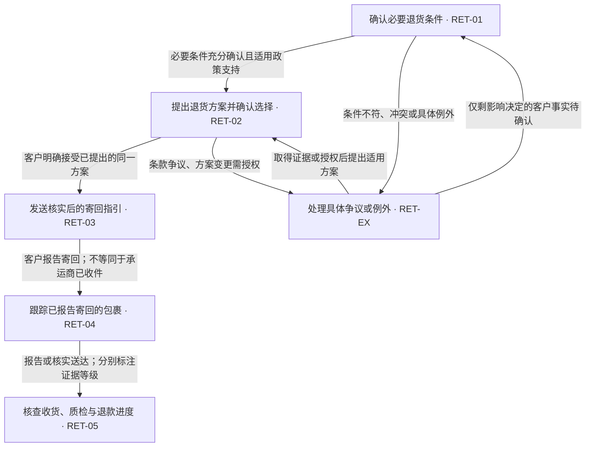

# Return 业务流程

> 自动生成，请修改 resources/data/ticket-return-playbook-v1.json，再运行 php artisan tickets:return-flow-check --write-doc。

流程版本：1.1.0；格式版本：1.0；维护角色：customer_service_operations；范围：本地待人工审核草稿。

Standard physical returns and related communication. Case-bound evidence and applicable site policy determine eligibility, fees and deadlines. Special settlements require explicit authorization. Local human-reviewed drafts only; no business execution.

required_evidence 表示必须评估的证据类别，不代表接口一定可用。证据缺失时按节点异常出口和实际回复要求判断 readiness；可解释政策基础的方案不因缺少最终地址退回条件询问。

## 阶段关系



关系图用于阅读；实际阶段每次由当前证据重新判定。已接受、已寄回等进度优先保留；新冲突阻止 ready，不重启初始问答。

## 实际路由顺序

Evaluate in array order; the first matching rule wins. Within when, positions, condition_statuses and exception_present are alternatives (OR). The final always rule is the only fallback. Reassess on new scoped evidence; these are stage selections, not executed transitions.

| 规则 | 条件 | 阶段 |
| --- | --- | --- |
| accepted_offer | `{"positions":["option_accepted"]}` | send_instructions |
| dispatched_return | `{"positions":["return_shipped"]}` | track_return |
| receipt_or_refund_review | `{"positions":["return_received","refund_issued"]}` | review_refund |
| specific_exception | `{"exception_present":true,"condition_statuses":["conflict","failed"]}` | exception_review |
| missing_eligibility | `{"condition_statuses":["missing"]}` | collect_conditions |
| eligible_proposal | `{"always":true}` | offer_options |

## 来源与权限

- site_policy（config/ticket-agent.php:return_policy_urls）：Current public policy for the identified site; retrieval time is not effective time. Conflicts or historical applicability require review.
- verified_knowledge（TicketPolicyRepository / KnowledgeArticle）：Verified, enabled site/intent bindings only. Preserve individually agreed terms; surface conflicts with public policy.
- team_guide（docs/policies/return-team-guide.md）：Process and examples only. Example prices, concessions and alternatives are not general authorization.
- case_evidence（TicketRuntimeContext / TicketFactResolver）：Scoped conversation and current identity-verified facts; customer reports, agent promises and confirmed executions are distinct.

## 工具能力与缺口

| 能力 | 当前状态 | 工具 | 跟进角色与限制 |
| --- | --- | --- | --- |
| conversation | available | read_conversation | customer_service：Incomplete or conflicting history requires targeted investigation; never assert no_reply from incomplete history. |
| policy | partial | read_policy, read_site_return_policy | policy_owner：No historical policy archive. Unknown effective date, unsupported site or conflicting sources require review. |
| order | partial | read_order | commerce_integration：Identity check exists; complete currency, discounts and original fee allocation are not guaranteed. Do not infer them. |
| documents | partial | list_documents, inspect_document | customer_service：Reads existing supported documents/OCR only. No return-form generation, attachment preparation or general visual damage verification. |
| destination | manual | read_policy, read_conversation | returns_operations：Obtain complete case-applicable address from verified guidance; no dedicated destination lookup or automatic address verification. |
| return_tracking | unavailable | read_return_status | logistics_integration：The tool reports capability gaps and extracted references; no actual return-carrier lookup is configured. |
| warehouse | unavailable | read_return_status | warehouse_integration：No warehouse receipt/inspection adapter. Postal tracking or customer claims cannot establish warehouse inspection. |
| refund_execution | unavailable | read_order | payments_operations：Order refund summaries do not prove gateway execution or settlement. No gateway query or refund execution tool. |

## 判断原则

- Read the prior agent questions together with the customer's answers. A concise reply can satisfy several requested conditions without repeating their exact wording.
- For ordinary fit issues, evaluate the overall state confirmation in context. Do not invent damage or require a separate undamaged statement merely because a checklist word was omitted. Concrete ambiguity or a damage allegation must be assessed, not ignored.
- Keep eligibility separate from offer preparation. Missing fee details or a final address do not undo satisfied condition checks.
- Use the first return-request date, not today's date or the date of an internal followup. Do not penalize customers for internal delays. Near-boundary dates and timezone uncertainty require specific review.
- Standard size-chart measurements stored on an order do not by themselves establish a custom-size purchase.
- An ordinary eligible return proposal can be drafted for human approval without an already executed approval action. Do not invent special keep-item compensation or donation options.
- A request to return is not acceptance of an offer that has never been presented. Conditional acceptance is not unconditional acceptance.
- Preserve advanced stages: accepted offer, dispatched return, receipt/inspection and refund execution are distinct. Do not restart initial eligibility questions after an evidenced agreement or dispatch.
- Unknown or conflicting eligibility goes to specific clarification or exception review, never automatic rejection. Customer claims and business confirmations must remain distinguishable.
- Track each requested item and issue. A multi-item order may have mixed eligibility; do not extend one item's result or refund amount to the whole order. Unresolved item scope requires specific review.
- A changed offer requires fresh agreement to the new terms. Do not treat acceptance of an earlier amount or destination as acceptance of a replacement offer.
- Customer-reported arrival damage or a missing seal at arrival is a separate claim, not automatic proof of customer misuse or automatic ordinary-return rejection.
- For any conflict discovered after an agreement or dispatch, preserve the advanced stage and agreed history, record the specific exception and require internal review before a ready reply. Do not reset the checklist.
- Never mark a customer report of delivery or a promised refund as verified warehouse receipt, inspection, gateway execution or customer settlement.
- Readiness is separate from stage: investigation complete, draft approved and business action complete are different outcomes. A ready draft still requires human approval and does not perform any action.

## RET-01 确认必要退货条件

`collect_conditions` — Ask only genuinely missing eligibility questions; do not repeat answered questions.

进入条件：

- Ordinary return request with genuinely missing eligibility facts, before agreement or dispatch.

必须评估：conversation, policy, order。补充证据：documents。

| 完成层次 | 标准 |
| --- | --- |
| 分析完成 | Identify each known/missing/conflicting condition and first request date with scoped evidence. |
| 草稿完成 | Ask only the missing customer facts that affect the decision; internal API/policy gaps are internal followups. |
| 业务完成 | Relevant answers arrive; reassess using applicable policy. Sending a question is not completion of eligibility. |

回复必含内容：acknowledge_known_details, ask_only_missing_conditions, explain_next_step。

异常出口：

- Policy, identity or relevant item cannot be established. → customer_service：Record the exact internal gap, preserve customer-supplied facts and hold readiness if it changes the decision.

对应语境案例：missing_condition。

```text
Hello,

Thank you for the details. [Acknowledge the relevant facts already supplied.]

[Ask only the specific unanswered question that changes the return decision, and explain why if necessary.]

[Explain the next step once that information is received.]

Kind regards,
[Site customer service signature]
```

## RET-02 提出退货方案并确认选择

`offer_options` — Conditions have been confirmed: provide the applicable return proposal and ask for acceptance. This is a draft proposal for human review, not executed approval.

进入条件：

- Conditions satisfied in context; no acceptance of an existing offer.
- Conditional acceptance remains negotiation unless a specific exception needs review.

必须评估：conversation, policy, order。补充证据：destination。

| 完成层次 | 标准 |
| --- | --- |
| 分析完成 | Establish eligible item scope, refund basis, supported fees and actual customer position. |
| 草稿完成 | Present the supported option, costs, receipt/inspection terms and request an explicit choice. Exact amount only with sufficient allocation and currency. |
| 业务完成 | Customer explicitly accepts the actual proposed terms; a draft proposal or generic return request is not acceptance. |

回复必含内容：acknowledge_confirmed_conditions, state_return_option, state_refund_basis_and_exclusions, state_return_shipping_responsibility, state_receipt_inspection_condition, request_customer_choice。

异常出口：

- Exact fee breakdown or currency is missing but policy basis is clear. → commerce_integration：Explain the evidenced refund basis without a guessed number; keep allocation as an internal followup.
- Policy conflicts, special compensation or changed terms need approval. → policy_owner：Seek case-bound authorization; do not copy example percentages or waive fees.

对应语境案例：confirmed_context, conditional_acceptance, internal_delay, mixed_item_scope。

```text
Hello,

Thank you for confirming the condition of the dress. [Acknowledge the fit problem briefly.]

[Present the applicable return option: evidenced item amount or exact supported refund basis, the designated destination when known, original-fee exclusions and who pays return postage.]

[Explain the evidenced receipt/inspection conditions before refund processing.]

Please let us know whether you would like to proceed with this option. [Explain that final return instructions and any actually required documents follow confirmation; do not claim files are attached.]

Kind regards,
[Site customer service signature]
```

## RET-03 发送核实后的寄回指引

`send_instructions` — Customer accepted an evidenced offer: give the matching final return instructions. If executable details are unavailable, retain this stage and flag internal preparation.

进入条件：

- Customer explicitly accepts an evidenced offer; identify which items and version of terms were accepted.

必须评估：conversation, policy, order, destination。补充证据：documents。

| 完成层次 | 标准 |
| --- | --- |
| 分析完成 | Preserve accepted terms; identify current complete destination and all actually applicable shipping/document requirements. |
| 草稿完成 | Supply verified address and usable instructions. Claim an attachment only when it actually exists and is included. Missing execution details mean holding/internal_review. |
| 业务完成 | Approved instructions were actually sent, and later shipment evidence starts tracking. Draft generation alone is not dispatch. |

回复必含内容：preserve_agreed_terms, provide_verified_address, provide_supported_shipping_requirements, explain_tracking_followup。

异常出口：

- Address, required documents, item identity or agreed terms are missing/conflicting. → returns_operations：Retain send_instructions; prepare the specific missing details internally and block ready instructions.

对应语境案例：accepted_offer。

```text
Hello,

Thank you for confirming your choice. [Restate the agreed return terms without adding deductions.]

[Provide the verified complete destination and actual available shipping instructions/documents.]

[Request the tracking number after dispatch and explain the evidenced next step.]

Kind regards,
[Site customer service signature]
```

## RET-04 跟踪已报告寄回的包裹

`track_return` — Customer reports dispatch: acknowledge supplied tracking/documents, check return capability and identify receipt/inspection followup. Do not repeat offer acceptance or eligibility questions.

进入条件：

- Customer reports dispatch or scoped evidence establishes it; retain original agreement even if earlier checklist facts are absent.

必须评估：conversation, return_tracking。补充证据：documents, warehouse。

| 完成层次 | 标准 |
| --- | --- |
| 分析完成 | Separate reported dispatch, postal reference, carrier acceptance and delivery evidence. Inspect supplied documents before asking again. |
| 草稿完成 | Acknowledge supplied evidence and explain the actual next step and query limits. Do not imply a carrier/warehouse lookup succeeded when unavailable. |
| 业务完成 | Carrier or warehouse returns independently verified progress; a receipt image alone does not complete delivery. |

回复必含内容：acknowledge_dispatch_evidence, distinguish_claim_from_verified_receipt, explain_actual_next_step。

异常出口：

- Carrier query unavailable, parcel delayed or delivery disputed. → logistics_integration：Create an internal followup in the analysis for actual investigation; do not claim a followup task was created by this drafting workflow.

对应语境案例：already_shipped。

```text
Hello,

Thank you for the return update. [Acknowledge the actual supplied tracking or documents without treating them as delivery proof.]

[Explain the current verified status and receipt/inspection next step under the agreed terms.]

Kind regards,
[Site customer service signature]
```

## RET-05 核查收货、质检与退款进度

`review_refund` — Assess evidenced warehouse receipt, inspection or payment result; distinguish a customer delivery claim from verified warehouse receipt and gateway execution.

进入条件：

- A return-receipt or refund result is reported or evidenced; this stage is for verification and is not itself execution proof.

必须评估：conversation, warehouse, refund_execution。补充证据：order, documents。

| 完成层次 | 标准 |
| --- | --- |
| 分析完成 | Distinguish delivery claim, warehouse receipt, inspection, agreed amount, gateway submission and settlement. Check actual existing refund/dispute evidence before proposing execution. |
| 草稿完成 | State only the supported processing status, unchanged agreed terms and actual remaining action. Gateway execution cannot be asserted by this workflow. |
| 业务完成 | Authorized operator and authoritative warehouse/payment evidence confirm the relevant completion. A promise, aggregate refund field or no new customer message does not prove settlement. |

回复必含内容：state_evidenced_processing_stage, preserve_agreed_terms, explain_actual_next_step。

异常出口：

- Receipt, inspection, payment or dispute status cannot be verified. → payments_operations：Record the specific missing confirmation and refer to warehouse/payments as appropriate; do not invent execution or timing.

对应语境案例：delivery_claim, refund_claim。

```text
Hello,

[State only the evidenced return, inspection or refund stage.]

[Explain the actual remaining step or verified result without inventing payment execution or settlement timing.]

Kind regards,
[Site customer service signature]
```

## RET-EX 处理具体争议或例外

`exception_review` — Explain or clarify the specific conflict/exception. Preserve ordinary return claims alongside quality disputes; never auto-reject or invent an exception.

进入条件：

- Outside ordinary conditions, conflicting policies/facts, mixed item scope, or a specific requested exception before advanced progress.

必须评估：conversation, policy。补充证据：order, documents。

| 完成层次 | 标准 |
| --- | --- |
| 分析完成 | Name the actual disputed fact or term, preserve ordinary return and quality claims, and identify the role able to resolve it. |
| 草稿完成 | Give targeted clarification or an evidenced explanation. Do not reject automatically or invent an approved alternative. |
| 业务完成 | New evidence or explicit scoped authorization resolves the issue; reassess while preserving agreed/executed history. |

回复必含内容：identify_specific_conflict, preserve_known_facts, give_targeted_next_step。

异常出口：

- No supported policy, authority or integration can resolve the issue. → policy_owner：Hold internally with a concrete missing decision; record a candidate knowledge gap for later review.

对应语境案例：outside_window, conditional_acceptance, mixed_item_scope。

```text
Hello,

[Acknowledge the customer's problem and the relevant facts.]

[Explain the specific unresolved issue and ask only for evidence that is necessary, or describe the internal action required.]

Kind regards,
[Site customer service signature]
```

## 维护与发布

Candidate change -> version bump -> structure/routing tests -> semantic model replay -> scoped human review -> local release/rollback. AI may propose; it must not self-publish policy or infer case exceptions as rules.

Opted-in factual/process/template feedback may produce an unapproved knowledge candidate through knowledge:synthesize-ticket-feedback. Individual decisions remain case-bound. Add a deidentified regression case for each confirmed failure.

监测指标：stage_accuracy, repeated_question_rate, unsupported_claim_rate, required_content_coverage, substantive_human_edit_rate, tool_calls_and_duration, blocker_by_capability。

发布检查：

- All deterministic cases pass; no unknown nodes/tools or missing exception exits.
- Run semantic replays for changed paths and inspect business meaning independently of AI review.
- Review authority, applicable site/effective date and preservation of existing commitments.
- Retain prior version and run evidence; repository publication and production acceptance are separate.
